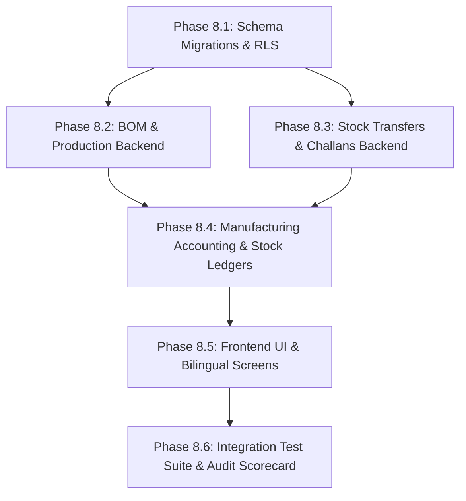

# Phase 8 Discovery & Architecture Plan: Distribution & Manufacturing

**Project:** `/home/dell/Jaydeep/Billing`  
**Current State:** Phase 7 Final Safety Gate Passed (178/178 tests green)  
**Document Purpose:** Architectural Discovery & Implementation Blueprint for Phase 8  
**Scope Mode:** **DISCOVERY ONLY** (No Phase 8 production code written during this step)  
**Date:** October 13, 2026  

---

## 1. Executive Summary

Phase 8 expands the Indian Billing & Accounting SaaS from micro-retail trading into **Distribution, Light Manufacturing, Multi-Warehouse Transfers, and Delivery Challans (GST Rule 55)**.

This discovery audit investigated the existing monorepo to identify:
1. Architectural foundations and database assets already prepared in Phase 1–7.
2. Missing services, controllers, DTOs, RLS policies, and UI screens.
3. Statutory Indian GST compliance (Schedule I deemed supplies, Rule 55 Delivery Challans, Job Work).
4. Double-entry accounting invariants (AS 2 / Ind AS 2 Inventory Valuation, WIP absorption, Scrap).

---

## 2. Existing Functionality to Reuse

The project was forward-designed with strong foundations for manufacturing and multi-warehouse operations. The following components will be reused directly without re-invention:

### A. Database Models (`packages/database/prisma/schema.prisma`)
* **`BillOfMaterial` (`bills_of_material`)**:
  - Columns: `id`, `organizationId`, `companyId`, `finishedItemId`, `bomName`, `batchYieldQty`, `laborCostEst`, `overheadCostEst`, `createdAt`.
  - Relation to finished `Item`.
* **`BomItem` (`bom_items`)**:
  - Columns: `id`, `bomId`, `rawItemId`, `quantity`, `wastagePercent`.
  - Normal wastage percentage configuration.
* **`ProductionOrder` (`production_orders`)**:
  - Columns: `id`, `organizationId`, `companyId`, `bomId`, `orderNumber`, `targetQuantity`, `status` (`ProductionStatus`: `PLANNED`, `IN_PROGRESS`, `COMPLETED`, `CANCELLED`), `startDate`, `completedDate`.
* **`ProductionBatch` (`production_batches`)**:
  - Columns: `id`, `productionOrderId`, `batchNumber`, `actualProducedQty`, `scrapQuantity`, `rawMaterialCost`, `actualLaborCost`, `actualOverheadCost`, `unitCost`, `completedAt`.
* **`ItemBatch` (`item_batches`)**:
  - Full batch tracking with `batchNumber`, `manufacturingDate`, `expiryDate`, `mrp`, and `costPrice`.
* **`Warehouse` (`warehouses`)**:
  - Multi-warehouse support with `isDefault`, `branchId`, and company scoping.

### B. Inventory & Ledger Foundations
* **`StockTransactionType` Enum**:
  - Pre-defined transaction types:
    - `MANUFACTURING_CONSUMPTION` (Raw material deduction)
    - `MANUFACTURING_YIELD` (Finished goods addition)
    - `STOCK_TRANSFER_IN` (Warehouse transfer receipt)
    - `STOCK_TRANSFER_OUT` (Warehouse transfer dispatch)
* **Append-Only Stock Ledger (`StockTransaction`)**:
  - Real-time stock aggregation, concurrency locking via advisory locks (`pg_advisory_xact_lock`), and FIFO/Weighted Average valuation fields.
* **Double-Entry Accounting Core (`vouchers.service.ts`, `ledgers.service.ts`)**:
  - Chart of accounts supports:
    - `1200` Stock-in-Hand (Raw Materials, WIP, Finished Goods)
    - `5100` Direct Expenses (Manufacturing Wages, Factory Overheads)
    - Balanced journal vouchers with tenant isolation.
* **Tenant Isolation & Security Framework**:
  - `executeInTenantContext(tenant, async (tx) => ...)` enforcing PostgreSQL Row-Level Security (RLS) on all tenant queries.

---

## 3. Missing Functionality (Gaps to Build)

| Area | Missing Component | Description |
|------|-------------------|-------------|
| **Database & RLS** | **Manufacturing RLS Policies** | `bills_of_material`, `bom_items`, `production_orders`, `production_batches` exist in schema, but PostgreSQL RLS policies (`ALTER TABLE ... ENABLE ROW LEVEL SECURITY`) must be added in a new migration. |
| **Database & RLS** | **Stock Transfer Models** | Need `StockTransfer` and `StockTransferItem` tables to record in-transit multi-warehouse transfers with dispatch/receive states (`PENDING`, `IN_TRANSIT`, `RECEIVED`, `REJECTED`). |
| **Database & RLS** | **Delivery Challan Model** | Need `DeliveryChallan` table under GST Rule 55 for job work, goods sent on approval, and branch transfers without sale. |
| **Backend API** | **`manufacturing` Module** | NestJS module with services, controllers, and DTOs for BOM CRUD, Production Order lifecycle, and Batch Yielding. |
| **Backend API** | **`transfers` Module** | NestJS module with services, controllers, and DTOs for inter-warehouse stock transfers. |
| **Backend API** | **`delivery-challans` Module**| NestJS module for Rule 55 Delivery Challan generation, sequential numbering, and conversion to Tax Invoice. |
| **Accounting** | **Manufacturing Accounting Vouchers** | Auto-posting journal vouchers for WIP capitalization and Finished Goods absorption. |
| **Frontend UI** | **`/manufacturing/bom`** | Bill of Materials management & formula calculator screen. |
| **Frontend UI** | **`/manufacturing/orders`** | Production order tracking & status workflow screen. |
| **Frontend UI** | **`/inventory/transfers`** | Inter-warehouse stock transfer dispatch & receipt screen. |
| **Frontend UI** | **`/sales/delivery-challans`** | Delivery Challan creation, PDF print, and invoice conversion screen. |

---

## 4. Proposed Implementation Order & Dependencies



### Order of Execution:
1. **Milestone 8.1 — Database Migration & RLS (Zero Breaking Changes):**
   - Apply `enable_rls_manufacturing_and_distribution` migration.
   - Add `StockTransfer`, `StockTransferItem`, `DeliveryChallan`, `DeliveryChallanItem`.
   - Add PostgreSQL RLS policies ensuring tenant isolation.
2. **Milestone 8.2 — Bill of Materials & Production Backend:**
   - Implement `BOMService` (BOM creation, yield formula, cost estimates).
   - Implement `ProductionOrderService` (Planning, status progression, batch number assignment).
3. **Milestone 8.3 — Manufacturing Assembly & Stock/Accounting Execution:**
   - Atomic production batch completion:
     - Consume raw materials (`MANUFACTURING_CONSUMPTION`).
     - Post scrap & normal wastage.
     - Yield finished goods (`MANUFACTURING_YIELD`) with created `ItemBatch`.
     - Post double-entry WIP capitalization and inventory journal vouchers.
4. **Milestone 8.4 — Distribution: Multi-Warehouse Transfers & Delivery Challans:**
   - Two-phase inter-warehouse transfers (Dispatch -> In-Transit -> Acknowledged Receipt).
   - Statutory Delivery Challans (Form GST DRC-01/Challan under Rule 55).
5. **Milestone 8.5 — UI & Bilingual Screens:**
   - Responsive, touch-friendly UI for BOM builder, Production run, Transfer notes, and Challans.
   - Bilingual Gujarati/English labels and receipt formats.
6. **Milestone 8.6 — Verification & Comprehensive Tests:**
   - Multi-tenant isolation tests, stock deduction tests, and accounting reconciliation tests.

---

## 5. Required Database Changes & Migration Risks

### Proposed Migration: `add_distribution_and_manufacturing_rls`
```sql
-- 1. Enable RLS on existing manufacturing tables
ALTER TABLE "bills_of_material" ENABLE ROW LEVEL SECURITY;
ALTER TABLE "production_orders" ENABLE ROW LEVEL SECURITY;

CREATE POLICY "tenant_isolation_bom" ON "bills_of_material"
  FOR ALL TO app_role
  USING (company_id = NULLIF(current_setting('app.current_company_id', true), '')::uuid);

CREATE POLICY "tenant_isolation_prod_orders" ON "production_orders"
  FOR ALL TO app_role
  USING (company_id = NULLIF(current_setting('app.current_company_id', true), '')::uuid);

-- 2. Create Stock Transfers
CREATE TABLE "stock_transfers" (
  "id" UUID PRIMARY KEY DEFAULT gen_random_uuid(),
  "organization_id" UUID NOT NULL REFERENCES "organizations"("id") ON DELETE CASCADE,
  "company_id" UUID NOT NULL REFERENCES "companies"("id") ON DELETE CASCADE,
  "transfer_number" VARCHAR(100) NOT NULL,
  "from_warehouse_id" UUID NOT NULL REFERENCES "warehouses"("id") ON DELETE RESTRICT,
  "to_warehouse_id" UUID NOT NULL REFERENCES "warehouses"("id") ON DELETE RESTRICT,
  "status" VARCHAR(50) NOT NULL DEFAULT 'PENDING',
  "transfer_date" DATE NOT NULL,
  "notes" TEXT,
  "created_at" TIMESTAMP WITH TIME ZONE DEFAULT NOW(),
  CONSTRAINT "uq_transfer_number" UNIQUE ("company_id", "transfer_number")
);
ALTER TABLE "stock_transfers" ENABLE ROW LEVEL SECURITY;
```

### Migration Risk Assessment & Mitigation:
* **Risk 1: Foreign key locks during migration:**
  - *Mitigation:* Tables will be created additively; zero alterations to existing `sales_invoices`, `parties`, or `vouchers` tables.
* **Risk 2: RLS policy lockouts for existing queries:**
  - *Mitigation:* Ensure `executeInTenantContext` and `executeBypassRls` both support the newly created tables.

---

## 6. Accounting, Inventory, GST & Tenant Isolation Considerations

### A. Inventory Valuation (AS 2 / Ind AS 2)
1. **Raw Material Consumption:** Valued at weighted average or FIFO purchase cost.
2. **Normal Wastage:** Cost of normal wastage is absorbed into the unit cost of yielded finished goods.
3. **Abnormal Scrap:** Credited against production costs and debited to Abnormal Loss Account (`5200`).
4. **Finished Goods Unit Cost:**
   $$\text{Unit Cost} = \frac{\text{Total Raw Material Cost} + \text{Actual Labor} + \text{Factory Overhead} - \text{Scrap Realized Value}}{\text{Actual Produced Quantity}}$$

### B. Statutory GST Compliance
1. **Rule 55 Delivery Challans:**
   - Goods dispatched for job work, transport between warehouses under same GSTIN, or approval sales must carry a serial Delivery Challan (Rule 55(1)).
   - Challan contains: HSN, quantity, description, taxable value, and GST rate, but is NOT a tax invoice.
2. **Schedule I Deemed Supplies:**
   - Stock transfers between branches located in different states (distinct persons under Section 25(4)) are deemed supplies and require an IGST Tax Invoice.
   - The UI will prompt whether destination warehouse belongs to the same GSTIN or an inter-state branch.

---

## 7. Acceptance Criteria & Automated Test Plan

1. **BOM Creation:** Can define bill of materials with multiple raw materials and wastage percentages.
2. **Production Run:** Completing a production run atomically deducts raw materials from origin warehouse and increments finished goods in target warehouse.
3. **Batch Creation:** Output products generate an `ItemBatch` with specified manufacturing and expiry dates.
4. **Voucher Balance:** Manufacturing journal voucher is perfectly balanced (Total Debits = Total Credits).
5. **Multi-Warehouse Transfer:** Cannot transfer more stock than available in source warehouse; receiving warehouse stock only increments upon confirmation.
6. **Delivery Challan:** Can issue Rule 55 Delivery Challan with serial sequence and optionally convert into a Tax Invoice upon delivery acceptance.
7. **Tenant Isolation:** Tenant B cannot see or manipulate Tenant A BOMs, production orders, or transfers.

---

## 8. Readiness Checklist

- [x] Existing database models audited
- [x] Accounting and valuation policies defined
- [x] GST Rule 55 statutory requirements mapped
- [x] Architecture dependencies planned
- [x] Phase 7 safety gate fully verified (10/10 PASS)
- [ ] User approval to initiate Phase 8 implementation
