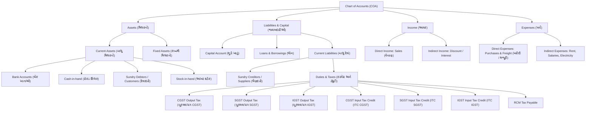

# Double-Entry Accounting Rules & Domain Invariants

> [!IMPORTANT]
> **Repository Implementation Status Notice**:
> This document specifies the **target double-entry accounting rules**. As verified by repository inspection on 12-Oct-2026, the current repository contains only design specifications; no ledger services, journal posting logic, or financial reporting calculators have been implemented in code yet.
>
> **Statutory Accounting Disclaimer**:
> Accounting treatments (Schedule III compliance, GST journal flows, TCS/TDS deductions, and year-end inventory valuation under AS-2 / Ind AS 2) must be reviewed and certified by a qualified Indian Chartered Accountant (CA) prior to deployment.

---

## 1. Principles of Indian Bookkeeping & Ledger Harmony

The accounting engine combines traditional Indian mercantile bookkeeping (_Deshi Nama Paddhati_ / _દેશી નામા પદ્ધતિ_) conventions with modern Anglo-Saxon double-entry accounting.

### 1.1 Traditional Indian vs Modern Double-Entry Mapping

| Indian Term (Gujarati) | Romanized Term    | Modern Accounting Equivalent         | Rules & Behavior                                                                       |
| :--------------------- | :---------------- | :----------------------------------- | :------------------------------------------------------------------------------------- |
| ઉધાર                   | Udhar             | Debit (Dr)                           | Increase in Asset/Expense; Decrease in Liability/Income                                |
| જમા                    | Jama              | Credit (Cr)                          | Increase in Liability/Income; Decrease in Asset/Expense                                |
| રોજમેળ                 | Rojmel            | Cash Book / Daily Cash Journal       | Two-column daily register tracking cash receipts (_Aavak_) and cash payments (_Javak_) |
| ખાતાવહી                | Khatavahi         | General Ledger                       | Individual ledger accounts for debtors, creditors, revenues, and assets                |
| આવડ                    | Aavad             | Day Book / Rough Transaction Journal | Chronological register of credit sales and purchases before ledger posting             |
| કાચું સરવૈયું          | Kachu Sarvaiyu    | Trial Balance                        | Schedule of debit and credit balances proving arithmetical accuracy                    |
| નફાનુકસાન ખાતું        | Nafanuksan Khatun | Profit & Loss Statement              | Calculation of gross profit and net profit/loss for the accounting period              |
| પાકું સરવૈયું          | Paku Sarvaiyu     | Balance Sheet                        | Statement of financial position: Assets (_Milkat_) vs Liabilities (_Denu_)             |
| વટાવ                   | Vataav            | Cash Discount / Trade Discount       | Discount allowed to customers or received from suppliers                               |
| દલાલી / આડત            | Dalali / Aadat    | Commission / Brokerage               | Intermediary commission in wholesale market trade                                      |

### 1.2 Mathematical Invariants

For every financial voucher $V$ in the system:

1. **Zero-Sum Balance Rule**:
   $$\sum_{i=1}^{n} \text{Debit}_i - \sum_{i=1}^{n} \text{Credit}_i = 0.00$$
2. **Precision Constraint**: Calculations take place with 4 decimal places for rates, but all journal entries must round to exactly 2 decimal places in `INR`. Any residual penny difference (e.g. $\pm ₹0.01$ to $\pm ₹0.99$) must balance into an auto-generated **Round Off Account** (_રાઉન્ડ ઓફ ખાતું_).
3. **Immutability of Closed Periods**: No journal voucher may be inserted, updated, or soft-deleted if `voucher_date` falls into a locked `FinancialYear` or prior to a finalized GST filing period.

---

## 2. Standard Indian Chart of Accounts (COA) Hierarchy

The platform provides a pre-configured, statutory-compliant Chart of Accounts tailored for Indian SMEs:

---

## 3. Transaction Posting Matrices

### 3.1 Intra-State Sales Invoice (Tax Invoice - Credit)

A wholesale sales invoice of ₹1,00,000 + 18% GST (9% CGST + 9% SGST) sold on credit to **Patel Provision Store**:

| Ledger Account                             | Category       | Debit (₹)       | Credit (₹)      | Narration               |
| :----------------------------------------- | :------------- | :-------------- | :-------------- | :---------------------- |
| **Patel Provision Store (Sundry Debtors)** | Current Asset  | **1,18,000.00** | 0.00            | Bill No. INV/26-27/0142 |
| **Sales Account (General Sales @ 18%)**    | Direct Income  | 0.00            | **1,00,000.00** | Taxable value           |
| **Output CGST @ 9%**                       | Duties & Taxes | 0.00            | **9,000.00**    | 9% Central GST          |
| **Output SGST @ 9%**                       | Duties & Taxes | 0.00            | **9,000.00**    | 9% State GST            |

### 3.2 Inter-State Sales Invoice with Trade Discount & Round-Off

A shipment to Rajasthan: Subtotal ₹50,000, Trade Discount 5% (₹2,500), Taxable ₹47,500, IGST @ 12% = ₹5,700, Round off ₹0.00:

| Ledger Account                          | Category       | Debit (₹)     | Credit (₹)    | Narration                |
| :-------------------------------------- | :------------- | :------------ | :------------ | :----------------------- |
| **Marwar Trading Co. (Sundry Debtors)** | Current Asset  | **53,200.00** | 0.00          | Inter-state dispatch     |
| **Sales Account (Inter-state @ 12%)**   | Direct Income  | 0.00          | **47,500.00** | Net of 5% trade discount |
| **Output IGST @ 12%**                   | Duties & Taxes | 0.00          | **5,700.00**  | Integrated GST           |

### 3.3 Purchase Invoice with Input Tax Credit (ITC)

Raw material purchased for ₹80,000 + 18% GST from **Gujarat Chemical Works**:

| Ledger Account                                | Category          | Debit (₹)     | Credit (₹)    | Narration                   |
| :-------------------------------------------- | :---------------- | :------------ | :------------ | :-------------------------- |
| **Purchase Account (Raw Material 18%)**       | Direct Expense    | **80,000.00** | 0.00          | Inward Invoice GCW/8821     |
| **Input CGST @ 9% (ITC)**                     | Duties & Taxes    | **7,200.00**  | 0.00          | Eligible Input Tax Credit   |
| **Input SGST @ 9% (ITC)**                     | Duties & Taxes    | **7,200.00**  | 0.00          | Eligible Input Tax Credit   |
| **Gujarat Chemical Works (Sundry Creditors)** | Current Liability | 0.00          | **94,400.00** | Payable against vendor bill |

### 3.4 Customer Payment Receipt with Cash Discount (_Vataav_)

Customer pays ₹1,15,000 via NEFT to settle invoice of ₹1,18,000, availed ₹3,000 cash discount:

| Ledger Account                             | Category         | Debit (₹)       | Credit (₹)      | Narration                         |
| :----------------------------------------- | :--------------- | :-------------- | :-------------- | :-------------------------------- |
| **HDFC Bank Current Account**              | Bank Account     | **1,15,000.00** | 0.00            | NEFT Ref # 9928192                |
| **Discount Allowed Account (Vataav)**      | Indirect Expense | **3,000.00**    | 0.00            | Cash discount 2.5%                |
| **Patel Provision Store (Sundry Debtors)** | Current Asset    | 0.00            | **1,18,000.00** | Full settlement of INV/26-27/0142 |

### 3.5 Sales Return (Credit Note / _જમા ચિઠ્ઠી_)

Return of defective goods valued at ₹10,000 + 18% GST:

| Ledger Account                             | Category                  | Debit (₹)     | Credit (₹)    | Narration                   |
| :----------------------------------------- | :------------------------ | :------------ | :------------ | :-------------------------- |
| **Sales Return Account**                   | Direct Income (Contra)    | **10,000.00** | 0.00          | Goods returned by customer  |
| **Output CGST @ 9%**                       | Duties & Taxes (Reversal) | **900.00**    | 0.00          | GST reversal on credit note |
| **Output SGST @ 9%**                       | Duties & Taxes (Reversal) | **900.00**    | 0.00          | GST reversal on credit note |
| **Patel Provision Store (Sundry Debtors)** | Current Asset             | 0.00          | **11,800.00** | CN/26-27/0012               |

---

## 4. Inventory Valuation & General Ledger Integration

The system supports two canonical integration modes between inventory and the general ledger:

### 4.1 Mode A: Periodic Trading Account Integration (Default for Indian MSME Retail & Wholesale)

- Sales and purchase invoices post directly to nominal **Sales Account** and **Purchase Account**.
- Individual quantities and valuations are recorded continuously in the `stock_transactions` ledger.
- The General Ledger does not post individual Cost of Goods Sold (COGS) on every retail invoice.
- Instead, at month-end or year-end, the physical stock valuation report (FIFO or WAC) determines the **Closing Stock** value, which is posted to the Trading Account:
  - **Debit**: Stock-in-Hand (Current Asset / Balance Sheet)
  - **Credit**: Closing Stock (Trading Account / Profit & Loss)
- Gross profit is determined via the statutory Trading Account equation:
  $$\text{Cost of Goods Sold (COGS)} = \text{Opening Stock} + \text{Purchases} + \text{Direct Expenses} - \text{Closing Stock}$$
  $$\text{Gross Profit} = \text{Total Sales} - \text{COGS}$$

### 4.2 Mode B: Perpetual Cost of Sales Mode (Optional for Enterprise & Manufacturing)

- When enabled by company policy (`inventoryIntegrationMode = PERPETUAL_COGS`), every sales dispatch generates an atomic secondary journal voucher:
  - **Debit**: Cost of Goods Sold (`COGS` - Direct Expense)
  - **Credit**: Stock-in-Hand (Current Asset)
- Values are determined dynamically from FIFO lots or Weighted Average Cost (WAC).

### 4.3 Negative Stock Valuation & Reconciliation

- If `allowNegativeStock = true`:
  - Outward dispatch on zero balance uses the item's `lastPurchaseRate` (or standard `purchaseRate`) as a provisional valuation rate.
  - The transaction is flagged with `isProvisionalCost = true`.
  - When inward stock is subsequently posted (GRN / Purchase Invoice), a background reconciliation job calculates the cost variance:
    $$\Delta \text{Cost} = \text{Actual Inward Cost} - \text{Provisional Cost}$$
  - The variance is updated in `stock_transactions.costVariance` and an adjusting entry is posted to `Stock Valuation Adjustment Account` if perpetual mode is active.

---

## 5. Bill-by-Bill Allocation, Credit Control & Aging

### 5.1 Bill-by-Bill Allocation Logic

Each receipt or payment voucher specifies an array of `PaymentAllocation` records linking the payment to outstanding invoice numbers:

1. **New Reference (`NEW_REF`)**: Created when a Sales Invoice or Purchase Invoice is issued.
2. **Against Reference (`AGST_REF`)**: Applied during Receipt, Payment, Credit Note, or Debit Note to reduce the pending balance of an existing bill.
3. **Advance (`ADVANCE`)**: Payment received before invoice creation. Automatically converted to `AGST_REF` when the invoice is finalized.
4. **On Account (`ON_ACCOUNT`)**: Lump-sum payment when bill reference is not provided by customer. Auto-settled using FIFO on oldest unpaid bills.

### 5.2 Credit Limit & Overdue Enforcement Policies

When a sales order or invoice is submitted:

1. **Total Exposure Check**:
   $$\text{Current Exposure} = \text{Unpaid Invoices Total} + \text{Unbilled Delivery Challans} + \text{Current Invoice Value} - \text{Unallocated Advances}$$
2. If $\text{Current Exposure} > \text{Party.creditLimit}$:
   - **Strict Block Policy**: Transaction blocked. Requires manager passcode or credit limit elevation.
   - **Soft Warning Policy**: Alert displayed to billing operator; audit event logged.
3. **Overdue Days Rule**: If party has any unpaid invoice where $(\text{CurrentDate} - \text{DueDate}) > \text{Party.creditDays}$, billing is restricted until older dues are settled.

### 5.3 Overdue Interest Calculation (_વ્યાજ ગણતરી_)

In Indian wholesale trading hubs (e.g. Surat textile market, Ahmedabad grain market, Rajkot engineering tools), default payment terms mandate interest on bills unpaid beyond 30 days:

$$\text{Interest Amount} = \frac{\text{Overdue Invoice Balance} \times \text{Annual Interest Rate (\%)} \times \text{Days Overdue}}{365 \times 100}$$

The system supports one-click generation of **Interest Debit Notes** with corresponding journal entries:

- Debit: Customer Ledger
- Credit: Interest Received Account (Indirect Income)

---

## 6. Financial Year-End Processing & Balance Transfer

At the close of 31st March:

1. **Trial Balance Verification**: All ledgers must balance ($\sum \text{Dr} = \sum \text{Cr}$).
2. **Nominal Accounts Closure**: All Income and Expense accounts are closed into the **Profit & Loss Account**.
3. **Net Profit Transfer**: P&L net balance is transferred into **Proprietor's Capital Account** or **Retained Earnings**.
4. **Carry Forward**: Real accounts (Assets) and Personal accounts (Debtors, Creditors, Banks, Cash) carry forward their closing balances as the **Opening Balances** of the new financial year (`FY 2027-28`).
5. **Year Locking**: Previous financial year status is updated to `isLocked = true`. No further modifications are permitted without statutory audit override credentials.
