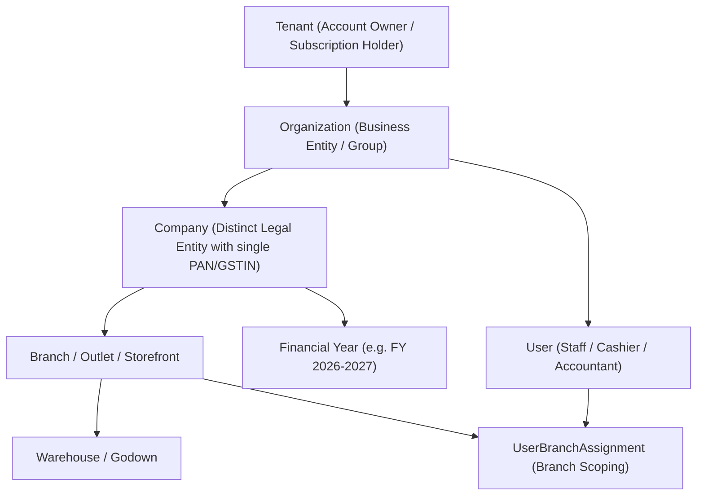
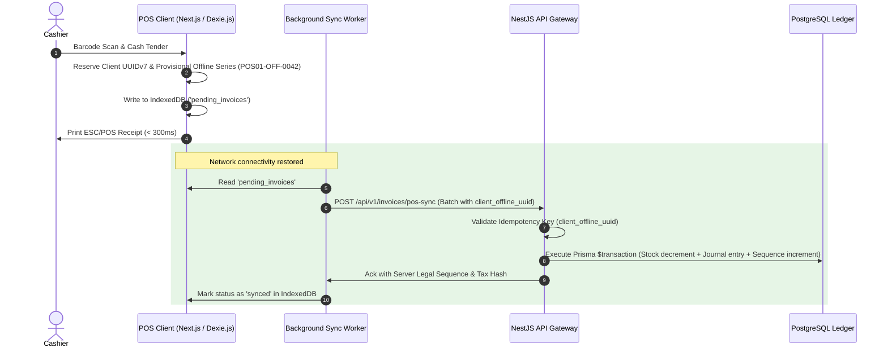

# System Architecture Blueprint

> [!IMPORTANT]
> **Repository Implementation Status Notice**:
> This document specifies the **target architectural blueprint**. As verified by repository inspection on 12-Oct-2026, the current repository contains only design specifications; no monorepo code, packages, or database migrations have been implemented yet.
>
> **Statutory Compliance Disclaimer**:
> Tax logic, E-Invoice thresholds, E-Way Bill rules, and MCA audit trail mechanisms outlined in this document are based on current provisions of the Central Goods and Services Tax (CGST) Act 2017 and the Companies Act 2013. These rules are subject to statutory amendments and official CBIC/MCA notifications. All implementations must be formally reviewed and certified by a qualified Indian Chartered Accountant (CA) or tax attorney prior to commercial production deployment.

---

## 1. Executive Summary & Product Vision

This document details the architectural blueprint for a cloud-native, offline-capable Indian billing, inventory, and accounting platform. The platform harmonizes the intuitive, mobile-first UX of **Vyapar** and **myBillBook** with the accounting depth, keyboard-driven productivity, and Gujarat-market specialization of **Miracle Accounting Software**.

### 1.1 Target Verticals & Workflows

1. **Retail**: High-throughput Point-of-Sale (POS), thermal receipt printing (2-inch and 3-inch ESC/POS), barcode/weighing-scale integration, cash drawer management, quick payment tenders (UPI dynamic QR, Cash, Split tender), and day-end cash register tallying (_Galla hisab_ / _ગલ્લા હિસાબ_).
2. **Wholesale**: Tiered/slab pricing, party-specific rate matrices, Bill-by-Bill credit limits, payment terms (credit days, cash discount slabs / _વટાવ_), aging schedules (_ઉઘરાણી યાદી_), and transport/lorry-receipt (LR) documentation.
3. **Distribution**: Multi-warehouse stocking, route/beat management, field salesman order capture, van sales dispatch, stock replenishment, and delivery challans.
4. **Manufacturing & Job Work**: Multi-level Bill of Materials (BOM), production runs with batch costing, scrap/by-product accounting, Job Work Outward/Inward challans with material reconciliation under Section 143 of the CGST Act.

### 1.2 Core Architectural Principles & Invariants

- **Single Ledger Truth**: Inventory movements, billings, payments, and adjustments map directly into double-entry journal vouchers (_Khatavahi_ / _ખાતાવહી_ and _Rojmel_ / _રોજમેળ_). No unlinked "shadow ledgers".
- **Strict Multi-Tenancy**: Organization-level and company-level data isolation using PostgreSQL Row-Level Security (RLS) combined with application-layer tenant context injection.
- **Offline-Resilient POS**: Retail checkout operations run offline via Web Workers and IndexedDB, syncing reliably with back-pressure handling, idempotent sequence reservations, and conflict resolution.
- **Bilingual Core**: First-class support for English and Gujarati (_ગુજરાતી_), including regional accounting conventions, Indian number formatting (Lakhs/Crores), and vernacular thermal invoice printing.
- **Compliance as Code**: Pluggable GST calculation, e-Way Bill generation, and e-Invoicing (IRN) with vendor-neutral abstractions (NIC, ClearTax, Masters India).

---

## 2. Monorepo Organization (Turborepo + pnpm)

The project is structured as a modular monorepo managed with **pnpm workspaces** and **Turborepo** to maximize code reuse between web, mobile-friendly PWA, background workers, and shared business logic.

```
billing-monorepo/
├── .github/                      # CI/CD workflows, linting, migration validation
├── apps/
│   ├── web/                      # Next.js 14+ App Router (PWA, Retail POS, ERP Web)
│   ├── api/                      # NestJS Modular Monolith (REST, WebSocket, Queue workers)
│   └── print-agent/              # Lightweight local desktop/tray agent for raw thermal ESC/POS
├── packages/
│   ├── database/                 # Prisma schema, migrations, seeders, RLS policies
│   ├── shared-types/             # TypeScript interfaces, Zod schemas, API contracts, Enums
│   ├── accounting-core/          # Double-entry ledger rules, financial math, journal engine
│   ├── tax-engine/               # Indian GST rules, HSN validations, Cess, TCS/TDS logic
│   ├── gst-provider/             # GSP/ASP adapter interfaces (NIC, ClearTax, Masters India)
│   ├── i18n/                     # English & Gujarati locale dictionaries, number formatters
│   ├── ui/                       # Design system tokens, keyboard shortcuts, accessible components
│   └── tsconfig/                 # Shared TypeScript configurations
├── docs/                         # Architectural, database, API, and accounting documentation
├── docker-compose.yml            # Local PostgreSQL, Redis, and Mailpit environments
├── pnpm-workspace.yaml           # Monorepo workspace configuration
├── turbo.json                    # Turborepo task pipeline definition
└── package.json                  # Root dependencies and scripts
```

### 2.1 Workspace Responsibilities

| Package / App              | Technology                                                        | Purpose                                                                                       |
| :------------------------- | :---------------------------------------------------------------- | :-------------------------------------------------------------------------------------------- |
| `apps/web`                 | Next.js 14+ (App Router), TypeScript, PWA (Serwist), Tailwind CSS | Responsive Web & POS UI, localized in EN and GU, IndexedDB offline cache via Dexie.js.        |
| `apps/api`                 | NestJS, Fastify, TypeScript, BullMQ                               | Business logic, ledger journalization, GST integrations, multi-tenant auth, REST API.         |
| `apps/print-agent`         | Electron / Node.js native                                         | Optional desktop daemon to bypass browser print dialogs for USB/Network thermal printers.     |
| `packages/database`        | Prisma ORM, PostgreSQL 16                                         | Relational data persistence, Prisma client extension with tenant scoping and RLS hooks.       |
| `packages/accounting-core` | TypeScript (Pure functions)                                       | Double-entry journal calculation, balancing validation, FIFO/WAC inventory cost evaluation.   |
| `packages/tax-engine`      | TypeScript (Pure functions)                                       | GST tax breakdown (CGST, SGST, IGST, UTGST, Cess), RCM, Section 170 rounding.                 |
| `packages/shared-types`    | Zod, TypeScript                                                   | Shared request/response DTOs, domain models, validation constraints.                          |
| `packages/i18n`            | JSON dictionaries, Intl formatters                                | Vernacular strings (English, Gujarati), number-to-words (Lakh/Crore) in English and Gujarati. |

---

## 3. High-Level System Architecture

```mermaid
graph TB
    subgraph Client Layer
        WebClient["Web Browser / Tablet (Next.js PWA)"]
        POSClient["Offline-Ready POS (IndexedDB + Dexie)"]
        PrintAgent["Local Print Agent (ESC/POS Daemon)"]
    end

    subgraph Edge & Gateway
        Cloudflare["Cloudflare CDN / WAF"]
        Ingress["Nginx / ALB Ingress Controller"]
    end

    subgraph Application Layer (NestJS Monolith)
        AuthModule["Auth & Tenant Context"]
        BillingModule["Billing & POS Engine"]
        InventoryModule["Inventory & Stock Valuation"]
        AccountingModule["Double-Entry Ledger Core"]
        MfgModule["Manufacturing & Job Work"]
        GstModule["GST Engine & E-Invoice / E-Way Adapter"]
    end

    subgraph Async Processing
        RedisQueue["Redis (BullMQ)"]
        WorkerPool["Background Workers (GST Sync, PDF Gen, Audit Logs)"]
    end

    subgraph Persistence Layer
        Postgres[(PostgreSQL 16 Multi-Tenant DB)]
        S3Storage[(Object Storage: Invoices, PDFs, Backups)]
    end

    subgraph External Integrations
        GSP["GST Suvidha Provider (ClearTax / Masters India / NIC)"]
        WhatsApp["WhatsApp Cloud API (Invoice & Reminder delivery)"]
        SMSService["SMS Gateway (DLT approved OTP & alerts)"]
        PaymentGateway["UPI Dynamic QR / Razorpay / Cashfree"]
    end

    WebClient --> Cloudflare --> Ingress --> AuthModule
    POSClient --> Cloudflare
    POSClient -. Local Print .-> PrintAgent

    AuthModule --> BillingModule
    AuthModule --> InventoryModule
    AuthModule --> AccountingModule
    AuthModule --> MfgModule
    AuthModule --> GstModule

    BillingModule --> RedisQueue
    GstModule --> RedisQueue
    RedisQueue --> WorkerPool

    BillingModule --> Postgres
    InventoryModule --> Postgres
    AccountingModule --> Postgres
    WorkerPool --> Postgres
    WorkerPool --> S3Storage

    WorkerPool --> GSP
    WorkerPool --> WhatsApp
    WorkerPool --> SMSService
    BillingModule --> PaymentGateway
```

---

## 4. Multi-Tenancy & Data Isolation Model

The platform uses a **Shared Database, Shared Schema with Logical Isolation and PostgreSQL Row-Level Security (RLS)** approach.

### 4.1 Tenancy Hierarchy



1. **Tenant**: Top-level subscription billing account (e.g., owner phone number or primary email).
2. **Organization**: Multi-company corporate group. Enables multi-entity consolidated reporting.
3. **Company**: Individual legal entity possessing its own PAN, GSTIN, and independent Chart of Accounts.
4. **Branch**: Operational business unit (e.g., Surat Shop, Ahmedabad Godown). Each branch operates one or more warehouses.
5. **Warehouse**: Physical stock location where physical inventory is stored and counted.
6. **Financial Year**: Indian fiscal year (April 1 to March 31). Sequences, voucher balances, and closing entries belong strictly to a Company and Financial Year.
7. **User & Branch Scoping**: Users belong to an Organization. Through `UserBranchAssignment`, users are granted specific roles per branch (e.g., Cashier at Branch 1, Branch Manager at Branch 2).

### 4.2 Tenant Isolation Mechanism

To guarantee complete isolation:

1. Every business entity table includes `organization_id` and `company_id`. Location-specific records include `branch_id`.
2. PostgreSQL RLS policies enforce isolation at the database layer.
3. Application connections run within a transaction where session variables are set before query execution:
   ```sql
   SET LOCAL app.current_tenant_id = 'ten_xyz123';
   SET LOCAL app.current_organization_id = 'org_abc456';
   SET LOCAL app.current_company_id = 'cmp_789def';
   ```
4. **Prisma Client Extension**: A Prisma extension intercepts every query, reads tenant context from `AsyncLocalStorage` (managed by NestJS interceptors), and enforces where clauses as a fail-safe defense-in-depth layer.

```typescript
// Prisma Client Extension for Tenant Scoping
export const tenantExtension = Prisma.defineExtension((client) => {
  return client.$extends({
    query: {
      $allModels: {
        async $allOperations({ model, operation, args, query }) {
          const tenantContext = TenantContextStorage.getStore();
          if (!tenantContext || tenantContext.isSystemBypass) {
            return query(args);
          }

          // Enforce company_id and organization_id filters on read/write operations
          if (
            [
              "findUnique",
              "findFirst",
              "findMany",
              "count",
              "update",
              "delete",
            ].includes(operation)
          ) {
            args.where = {
              ...args.where,
              organizationId: tenantContext.organizationId,
              companyId: tenantContext.companyId,
            };
          }
          return query(args);
        },
      },
    },
  });
});
```

---

## 5. Offline-First PWA Synchronization for Retail POS

Retail shops require instant checkout (< 2 seconds per ticket) and must remain fully operational when internet drops.

### 5.1 Architecture



### 5.2 Conflict Resolution and Sequence Management

- **Client-Side UUIDv7**: Invoices created offline use UUIDv7 (timestamp-ordered UUIDs) as their permanent primary identifier.
- **Offline Provisional Bill Number**: Offline bills print with an offline sequence prefix (e.g. `POS01-OFF-0042`).
- **Server Confirmation & Idempotency**: Upon sync, the server validates tax calculations, assigns the final legal GST series bill number (if required by company policy), decreases server inventory using transactional row-level locks, and returns a verified confirmation token.
- **Negative Stock & Cost Reconciliation**: When enabled by company policy, sales on zero system inventory are permitted with a provisional cost rate (`item.lastPurchaseRate`). Upon subsequent GRN/Purchase bill entry, a FIFO lot backfill job calculates cost variance and records a stock valuation adjustment.

---

## 6. Gujarati & Vernacular Localization Architecture

A major differentiator across Gujarat, Saurashtra, and Surat trading hubs is deep familiarity with Gujarati business terminology and ledger workflows.

### 6.1 Localization Stack

- **Framework**: `next-intl` on frontend, structured JSON localization catalogs in `packages/i18n`.
- **Dual Display Mode**: Options to toggle:
  - English Only (`en`)
  - Gujarati Only (`gu`)
  - Bilingual Mode (English header with Gujarati helper text, e.g. `Sundry Debtors / ગ્રાહક (દેવાદાર)`).

### 6.2 Regional Accounting Terminology Mapping

| Standard English Term    | Gujarati Business Term | Gujarati Script    | Semantic Usage in Software                               |
| :----------------------- | :--------------------- | :----------------- | :------------------------------------------------------- |
| Debit                    | Udhar                  | ઉધાર               | Left-side ledger entry / Outflow of benefit / Receivable |
| Credit                   | Jama                   | જમા                | Right-side ledger entry / Inflow of benefit / Payable    |
| Cash Book                | Rojmel                 | રોજમેળ             | Daily cash receipt and payment journal                   |
| Day Book                 | Aavad                  | આવડ                | Daily rough transaction register before posting          |
| General Ledger           | Khatavahi              | ખાતાવહી            | Individual party and nominal accounts ledger             |
| Customer / Debtor        | Asami / Grahak         | આસામી / ગ્રાહક     | Party who owes money for goods purchased                 |
| Supplier / Creditor      | Vepari                 | વેપારી             | Vendor from whom goods are purchased                     |
| Sales Bill               | Pakku Bill / Vechan    | પાકું બિલ / વેચાણ  | Formal GST Tax Invoice                                   |
| Estimate / Quotation     | Kachhu Bill / Kotation | કાચું બિલ / કોટેશન | Non-tax quotation / delivery estimate                    |
| Outstanding Balance      | Baki Rakham            | બાકી રકમ           | Unpaid balance on customer/vendor account                |
| Broker / Agent           | Dalal                  | દલાલ               | Commission broker in wholesale textile/grain markets     |
| Transport / Goods Inward | Avak Mal / Ponch       | આવક માલ / પહોંચ    | Goods receipt / Lorry Receipt acknowledgment             |

### 6.3 Vernacular Number & Currency Rendering

- Number format follows Indian grouping: `₹12,34,567.89` (not international `1,234,567.89`).
- Amount in words in Gujarati: e.g. `₹15,420` rendered as:
  - English: _Fifteen Thousand Four Hundred Twenty Rupees Only_
  - Gujarati: _અક્ષરે રૂપિયા પંદર હજાર ચારસો વીસ પુરા_
- Dual-font ESC/POS printer support utilizing Gujarati raster bitmap font rendering when printing on legacy non-Unicode thermal printers.

---

## 7. Security, Role-Based Access Control (RBAC) & Auditability

### 7.1 Role Hierarchy

1. **Super Admin (Platform Support)**: Tenant management, billing, system metrics (no access to business books unless explicit support grant is activated).
2. **Organization Owner**: Complete control over all companies, bank accounts, and configurations.
3. **Company Admin / Chartered Accountant**: Full financial operations, backdated vouchers, GST filing lock, journal adjustments.
4. **Branch Manager**: Warehouse operations, invoice approvals, stock transfers for assigned branches.
5. **Billing Operator / Cashier**: Sales invoice creation, customer lookup, cash collection, thermal print for assigned branch. Restricted from viewing purchase prices, profit margins, or editing locked bills.
6. **Field Salesman / Van Agent**: Order booking, delivery collection, restricted to assigned route/beat.

### 7.2 Immutable Audit Trail (MCA Companies Act 2013 Compliance)

In compliance with Ministry of Corporate Affairs (MCA) audit trail rules for Indian businesses, every insert, edit, or cancellation of a financial voucher generates an immutable record:

- Stores `original_payload`, `modified_payload`, `changed_by_user_id`, `client_ip`, and `timestamp`.
- Modification logs use cryptographic hash chaining (`prev_hash` + SHA-256 of current change) to prove non-tampering during statutory audits.
