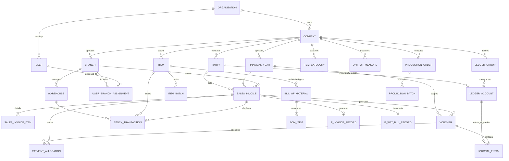

# Database Design & Prisma Schema Specification

> [!IMPORTANT]
> **Repository Implementation Status Notice**:
> This document specifies the **target database schema and relational design**. As verified by repository inspection on 12-Oct-2026, the current repository contains only design specifications; no database migrations or Prisma client code have been run or generated yet.
>
> **Statutory Compliance Disclaimer**:
> Tax structures, invoice numbering rules (GST Rule 46(b)), and audit trail specifications (MCA Audit Trail Notification) must be verified with a qualified Indian Chartered Accountant (CA) for statutory compliance with prevailing laws.

---

## 1. Overview & Data Modeling Strategy

The database architecture is designed for PostgreSQL 16 utilizing Prisma ORM. It serves micro-retailers up to multi-branch distribution and light manufacturing enterprises.

### 1.1 Core Design Pillars

1. **Strict Multi-Tenant Scoping**: All tenant-scoped tables enforce composite foreign keys and composite indexes rooted in `(organization_id, company_id)`.
2. **Deterministic Monetary Precision**: All monetary values use `DECIMAL(15, 2)` for finalized currency totals, and `DECIMAL(15, 4)` for unit rates, discounts, tax rates, and fractional stock units. Floating-point types are strictly forbidden.
3. **Double-Entry Synchronization**: Every invoice, payment, credit note, and debit note triggers a balanced pair of debit and credit rows in `journal_entries` within the exact same database transaction.
4. **Physical Stock Integrity**: Physical inventory is never updated via arbitrary mutable counters. Instead, all changes are written to an append-only `stock_transactions` ledger, with indexed materialization views for balance reporting.
5. **Auditing & MCA Compliance**: Statutory audit logging with cryptographic chaining on all financial documents.

---

## 2. Entity Relationship Diagram (ERD)



---

## 3. Complete Prisma Schema (`schema.prisma`)

```prisma
datasource db {
  provider = "postgresql"
  url      = env("DATABASE_URL")
}

generator client {
  provider        = "prisma-client-js"
  previewFeatures = ["fullTextSearch", "postgresqlExtensions"]
}

// ---------------------------------------------------------
// 1. TENANCY, ROLES & AUDITING
// ---------------------------------------------------------

enum SubscriptionTier {
  TRIAL
  RETAIL_BASIC
  WHOLESALE_PRO
  DISTRIBUTION_ENTERPRISE
  MANUFACTURING_SUITE
}

enum UserRole {
  SUPER_ADMIN
  ORG_ADMIN
  COMPANY_ADMIN
  ACCOUNTANT
  BRANCH_MANAGER
  CASHIER
  SALESMAN
  AUDITOR
}

enum GstRegistrationType {
  REGULAR
  COMPOSITION
  UNREGISTERED
  CONSUMER
  OVERSEAS
  SPECIAL_ECONOMIC_ZONE
}

enum ValuationMethod {
  FIFO
  WEIGHTED_AVERAGE
  BATCH_ACTUAL
}

enum InventoryIntegrationMode {
  PERIODIC_TRADING   // Standard SME Mode: Stock valued in ledger at month/year end
  PERPETUAL_COGS     // Enterprise Mode: Real-time COGS Dr & Stock Cr on dispatch
}

model Tenant {
  id               String            @id @default(uuid()) @db.Uuid
  primaryPhone     String            @unique @map("primary_phone") @db.VarChar(20)
  primaryEmail     String?           @unique @map("primary_email") @db.VarChar(255)
  subscriptionTier SubscriptionTier  @default(TRIAL) @map("subscription_tier")
  subscriptionEnds DateTime          @map("subscription_ends_at")
  isActive         Boolean           @default(true) @map("is_active")
  createdAt        DateTime          @default(now()) @map("created_at")
  updatedAt        DateTime          @updatedAt @map("updated_at")
  organizations    Organization[]

  @@map("tenants")
}

model Organization {
  id        String    @id @default(uuid()) @db.Uuid
  tenantId  String    @map("tenant_id") @db.Uuid
  name      String    @db.VarChar(200)
  legalName String?   @map("legal_name") @db.VarChar(255)
  createdAt DateTime  @default(now()) @map("created_at")
  updatedAt DateTime  @updatedAt @map("updated_at")

  tenant    Tenant    @relation(fields: [tenantId], references: [id], onDelete: Cascade)
  companies Company[]
  users     User[]

  @@index([tenantId])
  @@map("organizations")
}

model Company {
  id                       String                   @id @default(uuid()) @db.Uuid
  organizationId           String                   @map("organization_id") @db.Uuid
  legalName                String                   @map("legal_name") @db.VarChar(255)
  tradeName                String                   @map("trade_name") @db.VarChar(255)
  gstin                    String?                  @db.VarChar(15)
  pan                      String?                  @db.VarChar(10)
  stateCode                String                   @map("state_code") @db.Char(2) // e.g. "24" for Gujarat
  gstType                  GstRegistrationType      @default(REGULAR) @map("gst_type")
  compositionScheme        Boolean                  @default(false) @map("composition_scheme")
  eInvoiceApplicable       Boolean                  @default(false) @map("e_invoice_applicable")
  currencyCode             String                   @default("INR") @map("currency_code") @db.VarChar(3)
  addressLine1             String                   @map("address_line1") @db.VarChar(255)
  addressLine2             String?                  @map("address_line2") @db.VarChar(255)
  city                     String                   @db.VarChar(100)
  district                 String?                  @db.VarChar(100)
  pincode                  String                   @db.VarChar(10)
  phone                    String                   @db.VarChar(20)
  email                    String?                  @db.VarChar(100)
  bankName                 String?                  @map("bank_name") @db.VarChar(100)
  bankAccountNo            String?                  @map("bank_account_no") @db.VarChar(50)
  bankIfsc                 String?                  @map("bank_ifsc") @db.VarChar(15)
  bankBranch               String?                  @map("bank_branch") @db.VarChar(100)
  upiVpa                   String?                  @map("upi_vpa") @db.VarChar(100)
  enableGujaratiPrint      Boolean                  @default(true) @map("enable_gujarati_print")

  // Configurable Business Policies
  allowNegativeStock       Boolean                  @default(false) @map("allow_negative_stock")
  inventoryCostingMethod   ValuationMethod          @default(FIFO) @map("inventory_costing_method")
  inventoryIntegrationMode InventoryIntegrationMode @default(PERIODIC_TRADING) @map("inventory_integration_mode")

  createdAt                DateTime                 @default(now()) @map("created_at")
  updatedAt                DateTime                 @updatedAt @map("updated_at")

  organization             Organization             @relation(fields: [organizationId], references: [id], onDelete: Cascade)
  branches                 Branch[]
  financialYears           FinancialYear[]
  ledgerGroups             LedgerGroup[]
  ledgerAccounts           LedgerAccount[]
  parties                  Party[]
  itemCategories           ItemCategory[]
  items                    Item[]
  uoms                     UnitOfMeasure[]
  warehouses               Warehouse[]
  vouchers                 Voucher[]
  salesInvoices            SalesInvoice[]
  purchaseInvoices         PurchaseInvoice[]
  invoiceSequences         InvoiceSequence[]
  boms                     BillOfMaterial[]
  productionOrders         ProductionOrder[]
  auditLogs                AuditLog[]

  @@unique([gstin, organizationId])
  @@index([organizationId])
  @@map("companies")
}

model Branch {
  id             String    @id @default(uuid()) @db.Uuid
  organizationId String    @map("organization_id") @db.Uuid
  companyId      String    @map("company_id") @db.Uuid
  name           String    @db.VarChar(150)
  code           String    @db.VarChar(20) // e.g. "BR01", "AHD_MAIN"
  isMainBranch   Boolean   @default(false) @map("is_main_branch")
  addressLine1   String    @map("address_line1") @db.VarChar(255)
  city           String    @db.VarChar(100)
  pincode        String    @db.VarChar(10)
  stateCode      String    @map("state_code") @db.Char(2)
  phone          String    @db.VarChar(20)
  createdAt      DateTime  @default(now()) @map("created_at")
  updatedAt      DateTime  @updatedAt @map("updated_at")

  company        Company   @relation(fields: [companyId], references: [id], onDelete: Cascade)
  warehouses     Warehouse[]
  salesInvoices  SalesInvoice[]
  purchaseInvoices PurchaseInvoice[]
  posSessions    PosSession[]
  userAssignments UserBranchAssignment[]
  invoiceSequences InvoiceSequence[]

  @@unique([companyId, code])
  @@index([organizationId, companyId])
  @@map("branches")
}

model FinancialYear {
  id             String    @id @default(uuid()) @db.Uuid
  companyId      String    @map("company_id") @db.Uuid
  name           String    @db.VarChar(50) // e.g. "FY 2026-27"
  startDate      DateTime  @map("start_date") @db.Date
  endDate        DateTime  @map("end_date") @db.Date
  isLocked       Boolean   @default(false) @map("is_locked")
  isCurrent      Boolean   @default(false) @map("is_current")
  createdAt      DateTime  @default(now()) @map("created_at")

  company        Company   @relation(fields: [companyId], references: [id], onDelete: Cascade)
  vouchers       Voucher[]
  salesInvoices  SalesInvoice[]
  purchaseInvoices PurchaseInvoice[]
  invoiceSequences InvoiceSequence[]

  @@unique([companyId, startDate, endDate])
  @@index([companyId])
  @@map("financial_years")
}

model User {
  id             String       @id @default(uuid()) @db.Uuid
  organizationId String       @map("organization_id") @db.Uuid
  fullName       String       @map("full_name") @db.VarChar(150)
  email          String       @unique @db.VarChar(150)
  phone          String       @unique @db.VarChar(20)
  passwordHash   String       @map("password_hash") @db.VarChar(255)
  role           UserRole     @default(CASHIER)
  preferredLang  String       @default("en") @map("preferred_lang") @db.VarChar(5) // "en" | "gu"
  isActive       Boolean      @default(true) @map("is_active")
  createdAt      DateTime     @default(now()) @map("created_at")
  updatedAt      DateTime     @updatedAt @map("updated_at")

  organization   Organization @relation(fields: [organizationId], references: [id], onDelete: Cascade)
  auditLogs      AuditLog[]
  branchAssignments UserBranchAssignment[]

  @@index([organizationId])
  @@map("users")
}

model UserBranchAssignment {
  id        String   @id @default(uuid()) @db.Uuid
  userId    String   @map("user_id") @db.Uuid
  branchId  String   @map("branch_id") @db.Uuid
  role      UserRole
  isDefault Boolean  @default(false) @map("is_default")
  createdAt DateTime @default(now()) @map("created_at")

  user      User     @relation(fields: [userId], references: [id], onDelete: Cascade)
  branch    Branch   @relation(fields: [branchId], references: [id], onDelete: Cascade)

  @@unique([userId, branchId])
  @@index([userId])
  @@index([branchId])
  @@map("user_branch_assignments")
}

model AuditLog {
  id             String    @id @default(uuid()) @db.Uuid
  organizationId String    @map("organization_id") @db.Uuid
  companyId      String    @map("company_id") @db.Uuid
  userId         String    @map("user_id") @db.Uuid
  action         String    @db.VarChar(50) // e.g. "INVOICE_CREATE", "VOUCHER_UPDATE", "STOCK_ADJUST"
  entityName     String    @map("entity_name") @db.VarChar(50) // e.g. "SalesInvoice"
  entityId       String    @map("entity_id") @db.Uuid
  previousState  Json?     @map("previous_state")
  newState       Json?     @map("new_state")
  ipAddress      String?   @map("ip_address") @db.VarChar(45)
  userAgent      String?   @map("user_agent") @db.VarChar(255)
  prevHash       String?   @map("prev_hash") @db.VarChar(64) // Cryptographic hash chain
  recordHash     String    @map("record_hash") @db.VarChar(64)
  createdAt      DateTime  @default(now()) @map("created_at")

  company        Company   @relation(fields: [companyId], references: [id], onDelete: Cascade)
  user           User      @relation(fields: [userId], references: [id], onDelete: Restrict)

  @@index([organizationId, companyId, entityName, entityId])
  @@index([createdAt])
  @@map("audit_logs")
}

// ---------------------------------------------------------
// 2. CHART OF ACCOUNTS & DOUBLE-ENTRY CORE
// ---------------------------------------------------------

enum AccountNature {
  ASSET
  LIABILITY
  EQUITY
  INCOME
  EXPENSE
}

enum VoucherType {
  SALES
  PURCHASE
  PAYMENT
  RECEIPT
  CONTRA
  JOURNAL
  CREDIT_NOTE
  DEBIT_NOTE
}

model LedgerGroup {
  id             String          @id @default(uuid()) @db.Uuid
  organizationId String          @map("organization_id") @db.Uuid
  companyId      String          @map("company_id") @db.Uuid
  parentId       String?         @map("parent_id") @db.Uuid
  name           String          @db.VarChar(150)
  nameGujarati   String?         @map("name_gujarati") @db.VarChar(150)
  nature         AccountNature
  isSystem       Boolean         @default(false) @map("is_system")
  createdAt      DateTime        @default(now()) @map("created_at")

  company        Company         @relation(fields: [companyId], references: [id], onDelete: Cascade)
  parent         LedgerGroup?    @relation("SubGroups", fields: [parentId], references: [id], onDelete: Restrict)
  children       LedgerGroup[]   @relation("SubGroups")
  accounts       LedgerAccount[]

  @@unique([companyId, name])
  @@index([organizationId, companyId])
  @@map("ledger_groups")
}

model LedgerAccount {
  id             String          @id @default(uuid()) @db.Uuid
  organizationId String          @map("organization_id") @db.Uuid
  companyId      String          @map("company_id") @db.Uuid
  groupId        String          @map("group_id") @db.Uuid
  name           String          @db.VarChar(200)
  nameGujarati   String?         @map("name_gujarati") @db.VarChar(200)
  code           String?         @db.VarChar(50)
  isPartyLedger  Boolean         @default(false) @map("is_party_ledger")
  partyId        String?         @unique @map("party_id") @db.Uuid
  isBankLedger   Boolean         @default(false) @map("is_bank_ledger")
  isCashLedger   Boolean         @default(false) @map("is_cash_ledger")
  isTaxLedger    Boolean         @default(false) @map("is_tax_ledger")
  taxRate        Decimal?        @map("tax_rate") @db.Decimal(5, 2)
  openingBalance Decimal         @default(0.00) @map("opening_balance") @db.Decimal(15, 2)
  openingType    String          @default("DR") @map("opening_type") @db.Char(2) // "DR" | "CR"
  currentBalance Decimal         @default(0.00) @map("current_balance") @db.Decimal(15, 2)
  createdAt      DateTime        @default(now()) @map("created_at")
  updatedAt      DateTime        @updatedAt @map("updated_at")

  company        Company         @relation(fields: [companyId], references: [id], onDelete: Cascade)
  group          LedgerGroup     @relation(fields: [groupId], references: [id], onDelete: Restrict)
  party          Party?          @relation(fields: [partyId], references: [id], onDelete: SetNull)
  journalEntries JournalEntry[]

  @@unique([companyId, name])
  @@index([organizationId, companyId])
  @@map("ledger_accounts")
}

model Voucher {
  id              String          @id @default(uuid()) @db.Uuid
  organizationId  String          @map("organization_id") @db.Uuid
  companyId       String          @map("company_id") @db.Uuid
  financialYearId String          @map("financial_year_id") @db.Uuid
  voucherType     VoucherType     @map("voucher_type")
  voucherNumber   String          @map("voucher_number") @db.VarChar(100)
  voucherDate     DateTime        @map("voucher_date") @db.Date
  referenceNo     String?         @map("reference_no") @db.VarChar(100)
  narration       String?         @db.Text
  narrationGujarati String?      @map("narration_gujarati") @db.Text
  totalAmount     Decimal         @map("total_amount") @db.Decimal(15, 2)
  isAutoGenerated Boolean         @default(false) @map("is_auto_generated")
  isCancelled     Boolean         @default(false) @map("is_cancelled")
  sourceDocument  String?         @map("source_document") @db.VarChar(50) // "SALES_INVOICE", "PURCHASE_INVOICE"
  sourceEntityId  String?         @map("source_entity_id") @db.Uuid
  createdAt       DateTime        @default(now()) @map("created_at")
  updatedAt       DateTime        @updatedAt @map("updated_at")

  company         Company         @relation(fields: [companyId], references: [id], onDelete: Cascade)
  financialYear   FinancialYear   @relation(fields: [financialYearId], references: [id], onDelete: Restrict)
  journalEntries  JournalEntry[]
  allocations     PaymentAllocation[]

  @@unique([companyId, financialYearId, voucherType, voucherNumber])
  @@index([organizationId, companyId, voucherDate])
  @@index([sourceEntityId])
  @@map("vouchers")
}

model JournalEntry {
  id             String          @id @default(uuid()) @db.Uuid
  voucherId      String          @map("voucher_id") @db.Uuid
  accountId      String          @map("account_id") @db.Uuid
  debitAmount    Decimal         @default(0.00) @map("debit_amount") @db.Decimal(15, 2)
  creditAmount   Decimal         @default(0.00) @map("credit_amount") @db.Decimal(15, 2)
  lineNarration  String?         @map("line_narration") @db.VarChar(255)
  sequenceOrder  Int             @default(1) @map("sequence_order")

  voucher        Voucher         @relation(fields: [voucherId], references: [id], onDelete: Cascade)
  account        LedgerAccount   @relation(fields: [accountId], references: [id], onDelete: Restrict)

  @@index([voucherId])
  @@index([accountId])
  @@map("journal_entries")
}

model PaymentAllocation {
  id              String          @id @default(uuid()) @db.Uuid
  voucherId       String          @map("voucher_id") @db.Uuid // The receipt or payment voucher
  invoiceId       String          @map("invoice_id") @db.Uuid // Target SalesInvoice or PurchaseInvoice
  allocatedAmount Decimal         @map("allocated_amount") @db.Decimal(15, 2)
  cashDiscount    Decimal         @default(0.00) @map("cash_discount") @db.Decimal(15, 2)
  allocationDate  DateTime        @default(now()) @map("allocation_date")

  voucher         Voucher         @relation(fields: [voucherId], references: [id], onDelete: Cascade)
  salesInvoice    SalesInvoice?   @relation(fields: [invoiceId], references: [id], onDelete: Restrict)

  @@index([voucherId])
  @@index([invoiceId])
  @@map("payment_allocations")
}

// ---------------------------------------------------------
// 3. PARTIES (CUSTOMERS, SUPPLIERS, BROKERS)
// ---------------------------------------------------------

enum PartyType {
  CUSTOMER
  SUPPLIER
  BOTH
  BROKER
  JOB_WORKER
}

model Party {
  id              String              @id @default(uuid()) @db.Uuid
  organizationId  String              @map("organization_id") @db.Uuid
  companyId       String              @map("company_id") @db.Uuid
  type            PartyType           @default(CUSTOMER)
  name            String              @db.VarChar(200)
  nameGujarati    String?             @map("name_gujarati") @db.VarChar(200)
  contactPerson   String?             @map("contact_person") @db.VarChar(150)
  phone           String              @db.VarChar(20)
  email           String?             @db.VarChar(150)
  gstin           String?             @db.VarChar(15)
  pan             String?             @db.VarChar(10)
  gstType         GstRegistrationType @default(UNREGISTERED) @map("gst_type")
  stateCode       String              @map("state_code") @db.Char(2)
  billingAddress  Json                @map("billing_address")
  shippingAddress Json?               @map("shipping_address")
  creditLimit     Decimal             @default(0.00) @map("credit_limit") @db.Decimal(15, 2)
  creditDays      Int                 @default(0) @map("credit_days")
  interestRate    Decimal             @default(0.00) @map("interest_rate") @db.Decimal(5, 2) // e.g. 18.00% p.a.
  defaultDiscount Decimal             @default(0.00) @map("default_discount") @db.Decimal(5, 2)
  bankDetails     Json?               @map("bank_details")
  isActive        Boolean             @default(true) @map("is_active")
  createdAt       DateTime            @default(now()) @map("created_at")
  updatedAt       DateTime            @updatedAt @map("updated_at")

  company         Company             @relation(fields: [companyId], references: [id], onDelete: Cascade)
  ledgerAccount   LedgerAccount?
  salesInvoices   SalesInvoice[]
  purchaseInvoices PurchaseInvoice[]

  @@index([organizationId, companyId])
  @@index([phone])
  @@index([gstin])
  @@map("parties")
}

// ---------------------------------------------------------
// 4. INVENTORY, UOM, ITEMS, BATCHES & WAREHOUSES
// ---------------------------------------------------------

enum ItemType {
  PRODUCT
  SERVICE
}

model UnitOfMeasure {
  id             String    @id @default(uuid()) @db.Uuid
  organizationId String    @map("organization_id") @db.Uuid
  companyId      String    @map("company_id") @db.Uuid
  name           String    @db.VarChar(50) // e.g. "KILOGRAM", "BOX", "METER"
  symbol         String    @db.VarChar(20) // e.g. "KG", "BOX", "MTR"
  uqcCode        String    @map("uqc_code") @db.VarChar(10) // Standard Indian GST UQC
  decimalPlaces  Int       @default(2) @map("decimal_places")
  createdAt      DateTime  @default(now()) @map("created_at")

  company        Company   @relation(fields: [companyId], references: [id], onDelete: Cascade)
  itemsPrimary   Item[]    @relation("PrimaryUom")
  itemsSecondary Item[]    @relation("SecondaryUom")

  @@unique([companyId, symbol])
  @@map("units_of_measure")
}

model ItemCategory {
  id             String    @id @default(uuid()) @db.Uuid
  organizationId String    @map("organization_id") @db.Uuid
  companyId      String    @map("company_id") @db.Uuid
  name           String    @db.VarChar(100)
  nameGujarati   String?   @map("name_gujarati") @db.VarChar(100)
  createdAt      DateTime  @default(now()) @map("created_at")

  company        Company   @relation(fields: [companyId], references: [id], onDelete: Cascade)
  items          Item[]

  @@unique([companyId, name])
  @@map("item_categories")
}

model Item {
  id                  String          @id @default(uuid()) @db.Uuid
  organizationId      String          @map("organization_id") @db.Uuid
  companyId           String          @map("company_id") @db.Uuid
  categoryId          String?         @map("category_id") @db.Uuid
  type                ItemType        @default(PRODUCT)
  name                String          @db.VarChar(255)
  nameGujarati        String?         @map("name_gujarati") @db.VarChar(255)
  sku                 String?         @db.VarChar(100)
  barcode             String?         @db.VarChar(100)
  hsnCode             String          @map("hsn_code") @db.VarChar(10)
  primaryUomId        String          @map("primary_uom_id") @db.Uuid
  secondaryUomId      String?         @map("secondary_uom_id") @db.Uuid
  conversionFactor    Decimal?        @map("conversion_factor") @db.Decimal(12, 4) // e.g. 1 Box = 12 Pcs
  taxRate             Decimal         @map("tax_rate") @db.Decimal(5, 2) // e.g. 18.00%
  cessRate            Decimal         @default(0.00) @map("cess_rate") @db.Decimal(5, 2)
  cessPerUnit         Decimal         @default(0.00) @map("cess_per_unit") @db.Decimal(10, 4)
  purchaseRate        Decimal         @default(0.00) @map("purchase_rate") @db.Decimal(15, 4)
  retailPrice         Decimal         @default(0.00) @map("retail_price") @db.Decimal(15, 2)
  wholesalePrice      Decimal         @default(0.00) @map("wholesale_price") @db.Decimal(15, 2)
  mrp                 Decimal?        @db.Decimal(15, 2)
  minStockLevel       Decimal         @default(0.00) @map("min_stock_level") @db.Decimal(15, 4)
  reorderQuantity     Decimal         @default(0.00) @map("reorder_quantity") @db.Decimal(15, 4)
  trackBatches        Boolean         @default(false) @map("track_batches")
  trackSerialNo       Boolean         @default(false) @map("track_serial_no")
  valuationMethod     ValuationMethod @default(FIFO) @map("valuation_method")
  isActive            Boolean         @default(true) @map("is_active")
  createdAt           DateTime        @default(now()) @map("created_at")
  updatedAt           DateTime        @updatedAt @map("updated_at")

  company             Company         @relation(fields: [companyId], references: [id], onDelete: Cascade)
  category            ItemCategory?   @relation(fields: [categoryId], references: [id], onDelete: SetNull)
  primaryUom          UnitOfMeasure   @relation("PrimaryUom", fields: [primaryUomId], references: [id], onDelete: Restrict)
  secondaryUom        UnitOfMeasure?  @relation("SecondaryUom", fields: [secondaryUomId], references: [id], onDelete: SetNull)
  batches             ItemBatch[]
  salesInvoiceItems   SalesInvoiceItem[]
  purchaseInvoiceItems PurchaseInvoiceItem[]
  stockTransactions   StockTransaction[]
  bomOutputs          BillOfMaterial[]
  bomInputs           BomItem[]

  @@unique([companyId, sku])
  @@index([organizationId, companyId])
  @@index([barcode])
  @@index([hsnCode])
  @@map("items")
}

model ItemBatch {
  id             String    @id @default(uuid()) @db.Uuid
  itemId         String    @map("item_id") @db.Uuid
  batchNumber    String    @map("batch_number") @db.VarChar(100)
  mfgDate        DateTime? @map("mfg_date") @db.Date
  expiryDate     DateTime? @map("expiry_date") @db.Date
  purchaseRate   Decimal   @map("purchase_rate") @db.Decimal(15, 4)
  mrp            Decimal   @db.Decimal(15, 2)
  salePrice      Decimal   @map("sale_price") @db.Decimal(15, 2)
  barcode        String?   @db.VarChar(100)
  createdAt      DateTime  @default(now()) @map("created_at")

  item           Item      @relation(fields: [itemId], references: [id], onDelete: Cascade)
  stockTransactions StockTransaction[]

  @@unique([itemId, batchNumber])
  @@index([barcode])
  @@map("item_batches")
}

model Warehouse {
  id             String    @id @default(uuid()) @db.Uuid
  organizationId String    @map("organization_id") @db.Uuid
  companyId      String    @map("company_id") @db.Uuid
  branchId       String    @map("branch_id") @db.Uuid
  name           String    @db.VarChar(150)
  isDefault      Boolean   @default(false) @map("is_default")
  address        String?   @db.VarChar(255)
  createdAt      DateTime  @default(now()) @map("created_at")

  company        Company   @relation(fields: [companyId], references: [id], onDelete: Cascade)
  branch         Branch    @relation(fields: [branchId], references: [id], onDelete: Cascade)
  stockTransactions StockTransaction[]

  @@index([organizationId, companyId])
  @@map("warehouses")
}

enum StockTransactionType {
  OPENING
  PURCHASE_RECEIPT
  PURCHASE_RETURN
  SALES_DISPATCH
  SALES_RETURN
  SALES_CANCELLATION
  STOCK_TRANSFER_IN
  STOCK_TRANSFER_OUT
  MANUFACTURING_CONSUMPTION
  MANUFACTURING_YIELD
  STOCK_ADJUSTMENT_PLUS
  STOCK_ADJUSTMENT_MINUS
}

model StockTransaction {
  id               String               @id @default(uuid()) @db.Uuid
  organizationId   String               @map("organization_id") @db.Uuid
  companyId        String               @map("company_id") @db.Uuid
  warehouseId      String               @map("warehouse_id") @db.Uuid
  itemId           String               @map("item_id") @db.Uuid
  batchId          String?              @map("batch_id") @db.Uuid
  transactionType  StockTransactionType @map("transaction_type")
  transactionDate  DateTime             @map("transaction_date")
  quantity         Decimal              @db.Decimal(15, 4) // Positive for IN, Negative for OUT
  valuationRate    Decimal              @map("valuation_rate") @db.Decimal(15, 4)
  totalValuation   Decimal              @map("total_valuation") @db.Decimal(15, 2)
  isProvisionalCost Boolean             @default(false) @map("is_provisional_cost")
  costVariance     Decimal              @default(0.00) @map("cost_variance") @db.Decimal(15, 4)
  referenceDocType String               @map("reference_doc_type") @db.VarChar(50) // "SALES_INVOICE", "GRN"
  referenceDocId   String               @map("reference_doc_id") @db.Uuid
  createdAt        DateTime             @default(now()) @map("created_at")

  warehouse        Warehouse            @relation(fields: [warehouseId], references: [id], onDelete: Restrict)
  item             Item                 @relation(fields: [itemId], references: [id], onDelete: Restrict)
  batch            ItemBatch?           @relation(fields: [batchId], references: [id], onDelete: SetNull)

  @@index([organizationId, companyId, itemId, warehouseId])
  @@index([referenceDocType, referenceDocId])
  @@map("stock_transactions")
}

// ---------------------------------------------------------
// 5. SALES, INVOICING, POS & E-INVOICE
// ---------------------------------------------------------

enum InvoiceCategory {
  TAX_INVOICE        // Regular B2B/B2C GST Tax Invoice (Pakku Bill)
  BILL_OF_SUPPLY     // Exempt or Composition Scheme bill
  EXPORT_INVOICE     // With or without payment of tax
  PROFORMA_INVOICE   // Non-financial quotation / estimate (Kachhu Bill)
  DELIVERY_CHALLAN   // Section 55 delivery challan
}

enum InvoiceStatus {
  DRAFT
  ISSUED
  PAID
  PARTIALLY_PAID
  OVERDUE
  CANCELLED
}

enum PaymentMode {
  CASH
  UPI_QR
  BANK_TRANSFER
  CHEQUE
  CREDIT_NOTE
  SPLIT
  UNPAID_CREDIT
}

model InvoiceSequence {
  id              String          @id @default(uuid()) @db.Uuid
  companyId       String          @map("company_id") @db.Uuid
  financialYearId String          @map("financial_year_id") @db.Uuid
  branchId        String?         @map("branch_id") @db.Uuid // Optional branch scoping
  prefix          String          @db.VarChar(20) // e.g. "INV/26-27/" or "BR01/26-27/"
  currentNumber   Int             @default(0) @map("current_number")
  padding         Int             @default(4) // e.g. 0001
  category        InvoiceCategory

  company         Company         @relation(fields: [companyId], references: [id], onDelete: Cascade)
  financialYear   FinancialYear   @relation(fields: [financialYearId], references: [id], onDelete: Cascade)
  branch          Branch?         @relation(fields: [branchId], references: [id], onDelete: Cascade)

  @@unique([companyId, financialYearId, branchId, prefix, category])
  @@map("invoice_sequences")
}

model SalesInvoice {
  id                   String           @id @default(uuid()) @db.Uuid
  organizationId       String           @map("organization_id") @db.Uuid
  companyId            String           @map("company_id") @db.Uuid
  branchId             String           @map("branch_id") @db.Uuid
  financialYearId      String           @map("financial_year_id") @db.Uuid
  partyId              String           @map("party_id") @db.Uuid
  category             InvoiceCategory  @default(TAX_INVOICE)
  invoiceNumber        String           @map("invoice_number") @db.VarChar(100)
  invoiceDate          DateTime         @map("invoice_date") @db.Date
  dueDate              DateTime?        @map("due_date") @db.Date
  status               InvoiceStatus    @default(ISSUED)
  paymentMode          PaymentMode      @default(UNPAID_CREDIT) @map("payment_mode")
  isB2B                Boolean          @default(false) @map("is_b2b")
  isReverseCharge      Boolean          @default(false) @map("is_reverse_charge")
  placeOfSupply        String           @map("place_of_supply") @db.Char(2) // State Code
  billingAddress       Json             @map("billing_address")
  shippingAddress      Json?            @map("shipping_address")

  // Amounts
  subTotal             Decimal          @map("sub_total") @db.Decimal(15, 2)
  discountTotal        Decimal          @default(0.00) @map("discount_total") @db.Decimal(15, 2)
  taxableAmount        Decimal          @map("taxable_amount") @db.Decimal(15, 2)
  cgstAmount           Decimal          @default(0.00) @map("cgst_amount") @db.Decimal(15, 2)
  sgstAmount           Decimal          @default(0.00) @map("sgst_amount") @db.Decimal(15, 2)
  igstAmount           Decimal          @default(0.00) @map("igst_amount") @db.Decimal(15, 2)
  cessAmount           Decimal          @default(0.00) @map("cess_amount") @db.Decimal(15, 2)
  roundOff             Decimal          @default(0.00) @map("round_off") @db.Decimal(6, 2)
  grandTotal           Decimal          @map("grand_total") @db.Decimal(15, 2)
  paidAmount           Decimal          @default(0.00) @map("paid_amount") @db.Decimal(15, 2)
  balanceAmount        Decimal          @map("balance_amount") @db.Decimal(15, 2)

  termsAndConditions   String?          @map("terms_and_conditions") @db.Text
  notes                String?          @db.Text
  clientOfflineUuid    String?          @unique @map("client_offline_uuid") @db.VarChar(100)
  provisionalCostReconciled Boolean     @default(true) @map("provisional_cost_reconciled")
  createdAt            DateTime         @default(now()) @map("created_at")
  updatedAt            DateTime         @updatedAt @map("updated_at")

  company              Company          @relation(fields: [companyId], references: [id], onDelete: Restrict)
  branch               Branch           @relation(fields: [branchId], references: [id], onDelete: Restrict)
  financialYear        FinancialYear    @relation(fields: [financialYearId], references: [id], onDelete: Restrict)
  party                Party            @relation(fields: [partyId], references: [id], onDelete: Restrict)
  items                SalesInvoiceItem[]
  allocations          PaymentAllocation[]
  eInvoiceRecord       EInvoiceRecord?
  eWayBillRecord       EWayBillRecord?

  @@unique([companyId, financialYearId, invoiceNumber])
  @@index([organizationId, companyId, invoiceDate])
  @@index([financialYearId])
  @@index([partyId])
  @@index([status])
  @@map("sales_invoices")
}

model SalesInvoiceItem {
  id              String        @id @default(uuid()) @db.Uuid
  invoiceId       String        @map("invoice_id") @db.Uuid
  itemId          String        @map("item_id") @db.Uuid
  description     String?       @db.VarChar(255)
  hsnCode         String        @map("hsn_code") @db.VarChar(10)
  quantity        Decimal       @db.Decimal(15, 4)
  unitPrice       Decimal       @map("unit_price") @db.Decimal(15, 4)
  discountPercent Decimal       @default(0.00) @map("discount_percent") @db.Decimal(5, 2)
  discountAmount  Decimal       @default(0.00) @map("discount_amount") @db.Decimal(15, 2)
  taxableAmount   Decimal       @map("taxable_amount") @db.Decimal(15, 2)
  taxRate         Decimal       @map("tax_rate") @db.Decimal(5, 2)
  cgstAmount      Decimal       @default(0.00) @map("cgst_amount") @db.Decimal(15, 2)
  sgstAmount      Decimal       @default(0.00) @map("sgst_amount") @db.Decimal(15, 2)
  igstAmount      Decimal       @default(0.00) @map("igst_amount") @db.Decimal(15, 2)
  cessAmount      Decimal       @default(0.00) @map("cess_amount") @db.Decimal(15, 2)
  totalAmount     Decimal       @map("total_amount") @db.Decimal(15, 2)

  invoice         SalesInvoice  @relation(fields: [invoiceId], references: [id], onDelete: Cascade)
  item            Item          @relation(fields: [itemId], references: [id], onDelete: Restrict)

  @@index([invoiceId])
  @@index([itemId])
  @@map("sales_invoice_items")
}

model PosSession {
  id             String    @id @default(uuid()) @db.Uuid
  branchId       String    @map("branch_id") @db.Uuid
  cashierId      String    @map("cashier_id") @db.Uuid
  openingCash    Decimal   @map("opening_cash") @db.Decimal(15, 2)
  closingCash    Decimal?  @map("closing_cash") @db.Decimal(15, 2)
  expectedCash   Decimal?  @map("expected_cash") @db.Decimal(15, 2)
  cashDifference Decimal?  @map("cash_difference") @db.Decimal(15, 2)
  openedAt       DateTime  @default(now()) @map("opened_at")
  closedAt       DateTime? @map("closed_at")
  notes          String?   @db.Text

  branch         Branch    @relation(fields: [branchId], references: [id], onDelete: Restrict)

  @@index([branchId, openedAt])
  @@map("pos_sessions")
}

// ---------------------------------------------------------
// 6. PURCHASES & VENDOR INVOICES
// ---------------------------------------------------------

model PurchaseInvoice {
  id                   String           @id @default(uuid()) @db.Uuid
  organizationId       String           @map("organization_id") @db.Uuid
  companyId            String           @map("company_id") @db.Uuid
  branchId             String           @map("branch_id") @db.Uuid
  financialYearId      String           @map("financial_year_id") @db.Uuid
  partyId              String           @map("party_id") @db.Uuid
  vendorInvoiceNumber  String           @map("vendor_invoice_number") @db.VarChar(100)
  invoiceDate          DateTime         @map("invoice_date") @db.Date
  placeOfSupply        String           @map("place_of_supply") @db.Char(2)
  taxableAmount        Decimal          @map("taxable_amount") @db.Decimal(15, 2)
  cgstAmount           Decimal          @default(0.00) @map("cgst_amount") @db.Decimal(15, 2)
  sgstAmount           Decimal          @default(0.00) @map("sgst_amount") @db.Decimal(15, 2)
  igstAmount           Decimal          @default(0.00) @map("igst_amount") @db.Decimal(15, 2)
  cessAmount           Decimal          @default(0.00) @map("cess_amount") @db.Decimal(15, 2)
  grandTotal           Decimal          @map("grand_total") @db.Decimal(15, 2)
  paidAmount           Decimal          @default(0.00) @map("paid_amount") @db.Decimal(15, 2)
  balanceAmount        Decimal          @map("balance_amount") @db.Decimal(15, 2)
  itcEligibility       String           @default("INPUT") @map("itc_eligibility") @db.VarChar(20)
  createdAt            DateTime         @default(now()) @map("created_at")

  company              Company          @relation(fields: [companyId], references: [id], onDelete: Restrict)
  branch               Branch           @relation(fields: [branchId], references: [id], onDelete: Restrict)
  financialYear        FinancialYear    @relation(fields: [financialYearId], references: [id], onDelete: Restrict)
  party                Party            @relation(fields: [partyId], references: [id], onDelete: Restrict)
  items                PurchaseInvoiceItem[]

  @@unique([companyId, partyId, vendorInvoiceNumber])
  @@index([organizationId, companyId, invoiceDate])
  @@index([financialYearId])
  @@map("purchase_invoices")
}

model PurchaseInvoiceItem {
  id              String          @id @default(uuid()) @db.Uuid
  invoiceId       String          @map("invoice_id") @db.Uuid
  itemId          String          @map("item_id") @db.Uuid
  hsnCode         String          @map("hsn_code") @db.VarChar(10)
  quantity        Decimal         @db.Decimal(15, 4)
  unitPrice       Decimal         @map("unit_price") @db.Decimal(15, 4)
  taxableAmount   Decimal         @map("taxable_amount") @db.Decimal(15, 2)
  taxRate         Decimal         @map("tax_rate") @db.Decimal(5, 2)
  cgstAmount      Decimal         @default(0.00) @map("cgst_amount") @db.Decimal(15, 2)
  sgstAmount      Decimal         @default(0.00) @map("sgst_amount") @db.Decimal(15, 2)
  igstAmount      Decimal         @default(0.00) @map("igst_amount") @db.Decimal(15, 2)
  totalAmount     Decimal         @map("total_amount") @db.Decimal(15, 2)

  invoice         PurchaseInvoice @relation(fields: [invoiceId], references: [id], onDelete: Cascade)
  item            Item            @relation(fields: [itemId], references: [id], onDelete: Restrict)

  @@index([invoiceId])
  @@map("purchase_invoice_items")
}

// ---------------------------------------------------------
// 7. MANUFACTURING, BOM & JOB WORK
// ---------------------------------------------------------

model BillOfMaterial {
  id             String          @id @default(uuid()) @db.Uuid
  organizationId String          @map("organization_id") @db.Uuid
  companyId      String          @map("company_id") @db.Uuid
  finishedItemId String          @map("finished_item_id") @db.Uuid
  bomName        String          @map("bom_name") @db.VarChar(150)
  batchYieldQty  Decimal         @map("batch_yield_qty") @db.Decimal(15, 4)
  laborCostEst   Decimal         @default(0.00) @map("labor_cost_est") @db.Decimal(15, 2)
  overheadCostEst Decimal        @default(0.00) @map("overhead_cost_est") @db.Decimal(15, 2)
  createdAt      DateTime        @default(now()) @map("created_at")

  company        Company         @relation(fields: [companyId], references: [id], onDelete: Cascade)
  finishedItem   Item            @relation(fields: [finishedItemId], references: [id], onDelete: Restrict)
  items          BomItem[]
  productionOrders ProductionOrder[]

  @@index([organizationId, companyId])
  @@map("bills_of_material")
}

model BomItem {
  id             String         @id @default(uuid()) @db.Uuid
  bomId          String         @map("bom_id") @db.Uuid
  rawItemId      String         @map("raw_item_id") @db.Uuid
  quantity       Decimal        @db.Decimal(15, 4)
  wastagePercent Decimal        @default(0.00) @map("wastage_percent") @db.Decimal(5, 2)

  bom            BillOfMaterial @relation(fields: [bomId], references: [id], onDelete: Cascade)
  rawItem        Item           @relation(fields: [rawItemId], references: [id], onDelete: Restrict)

  @@index([bomId])
  @@map("bom_items")
}

enum ProductionStatus {
  PLANNED
  IN_PROGRESS
  COMPLETED
  CANCELLED
}

model ProductionOrder {
  id             String           @id @default(uuid()) @db.Uuid
  organizationId String           @map("organization_id") @db.Uuid
  companyId      String           @map("company_id") @db.Uuid
  bomId          String           @map("bom_id") @db.Uuid
  orderNumber    String           @map("order_number") @db.VarChar(100)
  targetQuantity Decimal          @map("target_quantity") @db.Decimal(15, 4)
  status         ProductionStatus @default(PLANNED)
  startDate      DateTime         @map("start_date") @db.Date
  completedDate  DateTime?        @map("completed_date") @db.Date
  createdAt      DateTime         @default(now()) @map("created_at")

  company        Company          @relation(fields: [companyId], references: [id], onDelete: Cascade)
  bom            BillOfMaterial   @relation(fields: [bomId], references: [id], onDelete: Restrict)
  batches        ProductionBatch[]

  @@unique([companyId, orderNumber])
  @@map("production_orders")
}

model ProductionBatch {
  id                String          @id @default(uuid()) @db.Uuid
  productionOrderId String          @map("production_order_id") @db.Uuid
  batchNumber       String          @map("batch_number") @db.VarChar(100)
  actualProducedQty Decimal         @map("actual_produced_qty") @db.Decimal(15, 4)
  scrapQuantity     Decimal         @default(0.00) @map("scrap_quantity") @db.Decimal(15, 4)
  rawMaterialCost   Decimal         @map("raw_material_cost") @db.Decimal(15, 2)
  actualLaborCost   Decimal         @default(0.00) @map("actual_labor_cost") @db.Decimal(15, 2)
  actualOverheadCost Decimal        @default(0.00) @map("actual_overhead_cost") @db.Decimal(15, 2)
  unitCost          Decimal         @map("unit_cost") @db.Decimal(15, 4)
  completedAt       DateTime        @default(now()) @map("completed_at")

  productionOrder   ProductionOrder @relation(fields: [productionOrderId], references: [id], onDelete: Cascade)

  @@map("production_batches")
}

// ---------------------------------------------------------
// 8. E-INVOICE & E-WAY BILL COMPLIANCE TABLES
// ---------------------------------------------------------

model EInvoiceRecord {
  id             String       @id @default(uuid()) @db.Uuid
  invoiceId      String       @unique @map("invoice_id") @db.Uuid
  irn            String       @unique @db.VarChar(64)
  ackNo          String       @map("ack_no") @db.VarChar(50)
  ackDate        DateTime     @map("ack_date")
  signedInvoice  String       @map("signed_invoice") @db.Text
  signedQrCode   String       @map("signed_qr_code") @db.Text
  status         String       @default("ACT") @db.VarChar(10) // "ACT", "CNL"
  cancelReason   String?      @map("cancel_reason") @db.VarChar(255)
  cancelledAt    DateTime?    @map("cancelled_at")
  createdAt      DateTime     @default(now()) @map("created_at")

  invoice        SalesInvoice @relation(fields: [invoiceId], references: [id], onDelete: Cascade)

  @@map("einvoice_records")
}

model EWayBillRecord {
  id             String       @id @default(uuid()) @db.Uuid
  invoiceId      String       @unique @map("invoice_id") @db.Uuid
  ewbNumber      String       @unique @map("ewb_number") @db.VarChar(20)
  ewbDate        DateTime     @map("ewb_date")
  validUpto      DateTime     @map("valid_upto")
  distanceKm     Int          @map("distance_km")
  vehicleNumber  String?      @map("vehicle_number") @db.VarChar(20)
  transporterId  String?      @map("transporter_id") @db.VarChar(15)
  transporterName String?     @map("transporter_name") @db.VarChar(150)
  status         String       @default("ACT") @db.VarChar(10)
  createdAt      DateTime     @default(now()) @map("created_at")

  invoice        SalesInvoice @relation(fields: [invoiceId], references: [id], onDelete: Cascade)

  @@map("eway_bill_records")
}
```

---

## 4. PostgreSQL Row-Level Security (RLS) Implementation

To ensure non-negotiable isolation between tenants and organizations at the PostgreSQL kernel layer, RLS policies are applied across multi-tenant tables.

### 4.1 SQL Migration for RLS Setup

```sql
-- Enable Row Level Security on core ledger and invoice tables
ALTER TABLE sales_invoices ENABLE ROW LEVEL SECURITY;
ALTER TABLE vouchers ENABLE ROW LEVEL SECURITY;
ALTER TABLE journal_entries ENABLE ROW LEVEL SECURITY;
ALTER TABLE parties ENABLE ROW LEVEL SECURITY;
ALTER TABLE stock_transactions ENABLE ROW LEVEL SECURITY;

-- Create policy enforcing tenant and organization isolation
CREATE POLICY tenant_isolation_sales_invoices ON sales_invoices
    AS RESTRICTIVE
    USING (
        organization_id = NULLIF(current_setting('app.current_organization_id', true), '')::uuid
        AND company_id = NULLIF(current_setting('app.current_company_id', true), '')::uuid
    );

CREATE POLICY tenant_isolation_vouchers ON vouchers
    AS RESTRICTIVE
    USING (
        organization_id = NULLIF(current_setting('app.current_organization_id', true), '')::uuid
        AND company_id = NULLIF(current_setting('app.current_company_id', true), '')::uuid
    );

CREATE POLICY tenant_isolation_parties ON parties
    AS RESTRICTIVE
    USING (
        organization_id = NULLIF(current_setting('app.current_organization_id', true), '')::uuid
        AND company_id = NULLIF(current_setting('app.current_company_id', true), '')::uuid
    );
```

---

## 5. Transaction Boundaries & Concurrency Control

### 5.1 The Atomic Invoice Creation Boundary

When a sales invoice is created, multiple database mutations must occur within a single `$transaction`:

1. **Sequence Increment**: Lock and increment `invoice_sequences` using `SELECT FOR UPDATE` to prevent bill number gaps or race conditions.
2. **Sales Invoice Insert**: Insert `sales_invoices` and `sales_invoice_items`.
3. **Double-Entry Journal Post**: Insert `vouchers` (VoucherType `SALES`) and balanced `journal_entries` (Debit Customer, Credit Sales, Credit Tax accounts).
4. **Stock Ledger Depletion**: Insert negative records in `stock_transactions` for each item.
5. **Customer Outstanding Increment**: Atomically update `parties.current_balance` (or verify credit limit).
6. **Audit Trail Hash Chaining**: Append cryptographic entry to `audit_logs`.

```typescript
// Transactional boundary illustration in NestJS Prisma Service
export async function createSalesInvoiceTransactional(
  prisma: PrismaClient,
  dto: CreateSalesInvoiceDto,
  ctx: TenantContext,
): Promise<SalesInvoice> {
  return await prisma.$transaction(
    async (tx) => {
      // 1. Acquire pessimistic row lock on sequence counter
      const seq = await tx.$queryRaw<Array<{ current_number: number }>>`
      SELECT current_number FROM invoice_sequences 
      WHERE company_id = ${ctx.companyId}::uuid 
        AND financial_year_id = ${ctx.financialYearId}::uuid
        AND (branch_id = ${ctx.branchId}::uuid OR branch_id IS NULL)
        AND category = ${dto.category}::"InvoiceCategory"
      FOR UPDATE
    `;
      const nextNumber = (seq[0]?.current_number ?? 0) + 1;
      const formattedInvoiceNo = `${dto.prefix}${String(nextNumber).padStart(4, "0")}`;

      await tx.invoiceSequence.updateMany({
        where: {
          companyId: ctx.companyId,
          financialYearId: ctx.financialYearId,
          branchId: ctx.branchId ?? null,
          category: dto.category,
        },
        data: { currentNumber: nextNumber },
      });

      // 2. Persist invoice header & items
      const invoice = await tx.salesInvoice.create({
        data: {
          ...dto.header,
          invoiceNumber: formattedInvoiceNo,
          organizationId: ctx.organizationId,
          companyId: ctx.companyId,
          branchId: ctx.branchId,
          financialYearId: ctx.financialYearId,
          items: { create: dto.items },
        },
      });

      // 3. Post double-entry vouchers & journal lines
      await postSalesInvoiceJournals(tx, invoice, dto.items, ctx);

      // 4. Update stock transaction ledger
      await postStockDispatches(tx, invoice, dto.items, ctx);

      return invoice;
    },
    {
      isolationLevel: Prisma.TransactionIsolationLevel.Serializable,
      timeout: 10000,
    },
  );
}
```
