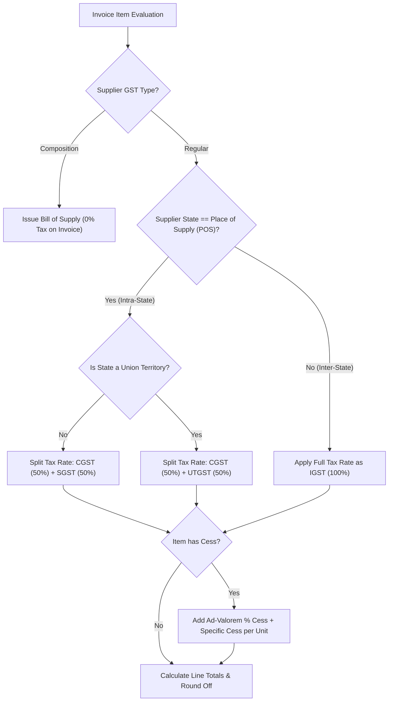
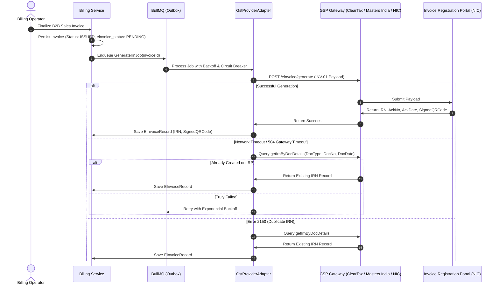
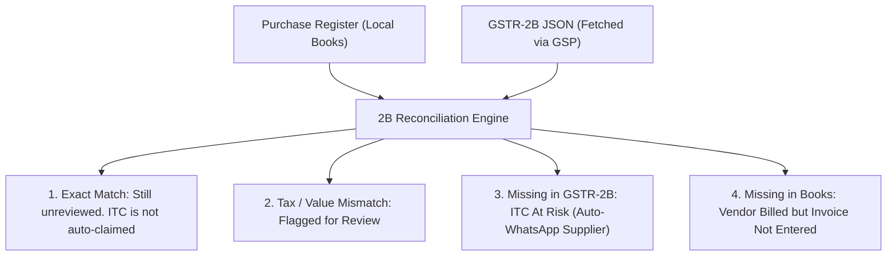

# Indian GST Integration & Compliance Architecture

> [!IMPORTANT]
> **Repository Implementation Status Notice**:
> Tax calculation, GSTR-1/GSTR-3B preparation, GSTR-2B reconciliation, and a NIC provider client now exist in code. The provider does not invent IRNs or e-way bill numbers. Production mode stays disabled until real credentials and the production gate are set. See `GST_COMPLIANCE_PHASE_REPORT.md` for the audited gaps. This document's sequence diagrams remain the target architecture, not a statement that a return has been filed.
>
> **Statutory Compliance Disclaimer**:
> Indian GST rules, e-Invoicing thresholds, e-Way bill exemptions, and HSN formatting are subject to periodic circulars and notifications issued by the Central Board of Indirect Taxes and Customs (CBIC) and the GST Council. All logic and schemas documented herein must be formally audited by a qualified Indian Chartered Accountant (CA) or GST practitioner prior to production release.

---

## 1. GST Regulatory Framework & Computation Engine

The tax computation engine enforces the legal requirements of the Central Goods and Services Tax (CGST) Act, State Goods and Services Tax (SGST) Act, and Integrated Goods and Services Tax (IGST) Act.

### 1.1 Tax Determination Logic



### 1.2 State Codes & Union Territories

The engine maintains the official 2-digit GST state codes:

| Code | State / UT                           | Type                | Code | State / UT  | Type                                  |
| :--- | :----------------------------------- | :------------------ | :--- | :---------- | :------------------------------------ |
| `24` | Gujarat                              | State (CGST + SGST) | `27` | Maharashtra | State (CGST + SGST)                   |
| `08` | Rajasthan                            | State (CGST + SGST) | `07` | Delhi       | UT with legislature (CGST + SGST)     |
| `26` | Dadra & Nagar Haveli and Daman & Diu | Union Territory     | `38` | Ladakh      | UT without legislature (CGST + UTGST) |

### 1.3 Canonical Mathematical Rounding Rules (Section 170 of CGST Act)

Under Section 170 of the CGST Act, the amount of tax, interest, penalty, fine or any other sum payable shall be rounded off to the nearest Rupee:

1. **Line-Item Tax Math**:
   - For each item line $i$:
     $$\text{lineTaxable}_i = \text{round}_2\left(\text{qty}_i \times \text{rate}_i \times \left(1 - \frac{\text{disc\%}_i}{100}\right) - \text{discAmt}_i\right)$$
   - Line taxes are computed with 4 decimal places for internal precision and rounded to 2 decimal places for database storage and print display (`cgstAmount`, `sgstAmount`, `igstAmount`).
2. **Invoice-Level Tax Summary (Slab Aggregation)**:
   - Taxable amounts are aggregated by tax rate slab $S \in \{0\%, 5\%, 12\%, 18\%, 28\%\}$:
     $$\text{cgstAmount} = \sum_{S} \text{round}_2\left(\text{slabTaxable}_S \times \frac{S}{2 \times 100}\right)$$
     $$\text{sgstAmount} = \sum_{S} \text{round}_2\left(\text{slabTaxable}_S \times \frac{S}{2 \times 100}\right)$$
     $$\text{igstAmount} = \sum_{S} \text{round}_2\left(\text{slabTaxable}_S \times \frac{S}{100}\right)$$
3. **Grand Total Nearest Rupee Rounding**:
   - $\text{preRoundTotal} = \text{taxableAmount} + \text{cgstAmount} + \text{sgstAmount} + \text{igstAmount} + \text{cessAmount}$
   - $\text{grandTotal} = \text{round}_0(\text{preRoundTotal})$ (nearest whole integer Rupee)
   - $\text{roundOff} = \text{grandTotal} - \text{preRoundTotal}$ (always between $-0.49$ and $+0.50$).

---

## 2. E-Invoicing (IRN) Architecture & Lifecycle

Mandatory under Rule 48(4) of CGST Rules for businesses exceeding the statutory aggregate turnover threshold (currently ₹5 Crores).

### 2.1 E-Invoice Processing Flow & Outbox Queue



### 2.2 IRN Hash Generation Formula

The 64-character hexadecimal IRN is uniquely generated by hashing:
$$\text{IRN} = \text{SHA256}(\text{SupplierGSTIN} + \text{FinancialYear} + \text{DocType} + \text{DocNumber})$$
_Example_: `SHA256("24AAAAA0000A1Z5" + "26-27" + "INV" + "INV/26-27/0142")`

### 2.3 Statutory 24-Hour Cancellation Rule

Under prevailing GSTN regulations:

- An IRN can be cancelled on the IRP portal **within 24 hours of generation only**.
- Once 24 hours have elapsed, cancellation on the IRP is locked and forbidden by the government server.
- **System Rule**: If an operator attempts to cancel an invoice after 24 hours, the system rejects the operation with error `IRN_CANCEL_WINDOW_EXPIRED` and instructs the user to issue a **Credit Note** (_જમા ચિઠ્ઠી_) instead.

---

## 3. E-Way Bill Integration & Threshold Rules

### 3.1 Threshold Rules & Movement Criteria

- **Inter-State Movement**: Consignment value exceeding ₹50,000 requires an E-Way bill across India.
- **Intra-State Movement (Gujarat)**: Consignment value exceeding ₹50,000 requires an E-Way bill (threshold is ₹1,00,000 for specific goods like textiles/yarns under Gujarat SGST notifications).
- **Mandatory Exemption**: E-Way bill is not required for non-motorized transport (hand carts, bullock carts) or within 20 km distance for weighing scale verification.

### 3.2 Validity Calculation

- **Regular Cargo**: 1 day for up to 200 km, and 1 additional day for every additional 200 km (or part thereof).
- **Over Dimensional Cargo (ODC)**: 1 day for up to 20 km, and 1 additional day for every 20 km (or part thereof).

---

## 4. GSP / ASP Provider Abstraction Architecture

To avoid vendor lock-in and provide maximum uptime, the system defines a vendor-neutral provider contract.

### 4.1 TypeScript Provider Interface (`packages/gst-provider`)

```typescript
export interface GstCredentials {
  gstin: string;
  clientId: string;
  clientSecret: string;
  username: string;
  passwordHash: string;
  authProvider: "NIC_DIRECT" | "CLEARTAX" | "MASTERS_INDIA" | "MOCK";
}

export interface EInvoicePayload {
  version: "1.1";
  tranDtls: {
    taxSch: "GST";
    supTyp: "B2B" | "B2C" | "SEZWP" | "SEZWOP" | "EXPWP" | "EXPWOP" | "DEXP";
    regRev?: "Y" | "N";
    igstOnIntra?: "Y" | "N";
  };
  docDtls: {
    typ: "INV" | "CRN" | "DBN";
    no: string;
    dt: string; // DD/MM/YYYY
  };
  sellerDtls: {
    gstin: string;
    lglNm: string;
    trdNm?: string;
    addr1: string;
    loc: string;
    pin: number;
    stcd: string;
  };
  buyerDtls: {
    gstin: string;
    lglNm: string;
    pos: string;
    addr1: string;
    loc: string;
    pin: number;
    stcd: string;
  };
  valDtls: {
    assVal: number;
    cgstVal: number;
    sgstVal: number;
    igstVal: number;
    cesVal: number;
    rndOffAmt: number;
    totInvVal: number;
  };
  itemList: Array<{
    slNo: string;
    prdDesc: string;
    isServc: "Y" | "N";
    hsnCd: string;
    qty: number;
    unit: string;
    unitPrice: number;
    totAmt: number;
    discount: number;
    assAmt: number;
    gstRt: number;
    igstAmt: number;
    cgstAmt: number;
    sgstAmt: number;
    totItemVal: number;
  }>;
}

export interface EInvoiceResponse {
  success: boolean;
  irn?: string;
  ackNo?: string;
  ackDate?: string;
  signedInvoice?: string;
  signedQrCode?: string;
  errorCode?: string;
  errorMessage?: string;
  errorMessageGujarati?: string;
}

export interface IEInvoiceProvider {
  generateIrn(
    payload: EInvoicePayload,
    creds: GstCredentials,
  ): Promise<EInvoiceResponse>;
  cancelIrn(
    irn: string,
    reason: string,
    remarks: string,
    creds: GstCredentials,
  ): Promise<boolean>;
  getIrnByDocDetails(
    docType: string,
    docNo: string,
    docDate: string,
    creds: GstCredentials,
  ): Promise<EInvoiceResponse>;
}

export interface IEwayBillProvider {
  generateEwayBill(
    payload: any,
    creds: GstCredentials,
  ): Promise<{
    ewbNumber: string;
    ewbDate: string;
    validUpto: string;
  }>;
  cancelEwayBill(
    ewbNo: string,
    reason: string,
    creds: GstCredentials,
  ): Promise<boolean>;
  updatePartBVehicle(
    ewbNo: string,
    vehicleNo: string,
    reason: string,
    creds: GstCredentials,
  ): Promise<boolean>;
}

export interface IGstProviderService
  extends IEInvoiceProvider, IEwayBillProvider {
  name: string;
}
```

---

## 5. GSTR Returns Generation & Reconciliation Engine

### 5.1 GSTR-1 Structure Mapping

The engine aggregates invoices into the statutory GSTR-1 JSON schema ready for one-click upload:

| Table        | Name                 | Description                                                                                                      |
| :----------- | :------------------- | :--------------------------------------------------------------------------------------------------------------- |
| **Table 4**  | B2B Invoices         | Taxable supplies made to registered persons (regular & reverse charge).                                          |
| **Table 5**  | B2C Large            | Inter-state supplies to unregistered persons where invoice value > ₹2,50,000.                                    |
| **Table 7**  | B2C Small            | Intra-state supplies to unregistered persons and inter-state supplies $\le$ ₹2,50,000 grouped by POS & Tax Rate. |
| **Table 8**  | Nil Rated / Exempt   | Supplies of goods/services with 0% tax rate or statutory exemption.                                              |
| **Table 9B** | Credit / Debit Notes | Registered credit and debit notes issued against B2B invoices.                                                   |
| **Table 12** | HSN Summary          | Mandatory summary of items grouped by HSN code, UQC, total quantity, and tax components.                         |
| **Table 13** | Documents Issued     | Serial numbers of tax invoices, credit notes, and delivery challans issued and cancelled.                        |

### 5.2 GSTR-2B Automated Purchase Reconciliation

Input Tax Credit (ITC) can only be claimed if the supplier has filed their GSTR-1 and the invoice appears in the buyer's **GSTR-2B** auto-generated statement (Section 16(2)(aa) of CGST Act).


