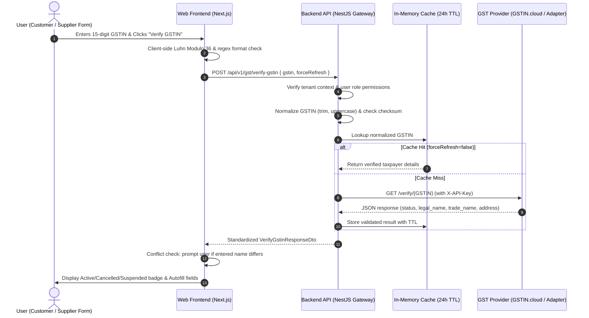

# GSTIN Verification & Autofill API Integration Guide

This guide describes the architecture, setup, provider onboarding, and operations for the GSTIN Verification API in **MyOwnBill History**.

---

## 1. Architecture Overview

The GSTIN Verification system provides real-time validation and business detail retrieval when creating or editing Customer and Supplier records.



### Key Architectural Tenets

1. **Provider-Agnostic Adapter Pattern**:
   The backend decouples the core billing platform from external providers via `IGstVerificationProvider` and `GstinProviderFactory`. Currently implemented providers:
   - `gstin_cloud` (Default primary candidate, official REST API: `https://gstin.cloud/dev-api/`)
   - `appyflow` (Secondary/legacy fallback)
   - `gstinapi` (Secondary/legacy fallback)
   - `mock` (Zero-network deterministic test runner)
2. **Never Call External APIs Directly from the Browser**:
   Provider API keys and credentials are kept strictly server-side.
3. **Statutory Checksum Pre-Validation**:
   Standard Indian GST Luhn Modulo 36 algorithm validates the 15th check digit before any external network call. If a typo is detected, a 1-click checksum correction is suggested.
4. **Tenant Isolation & Zero Database Bloat**:
   Verification requests execute in the authoritative `TenantContext`. Results are cached in memory (configurable TTL), and saved to the database only when the user explicitly saves the Customer or Supplier.

---

## 2. API Contract

### Endpoint

```http
POST /api/v1/gst/verify-gstin
```

### Authentication & Headers

- `Authorization: Bearer <JWT_TOKEN>`
- `x-organization-id: <ORGANIZATION_UUID>`
- `x-company-id: <COMPANY_UUID>`

### Request Body

```json
{
  "gstin": "27AAAAA0000A1Z2",
  "forceRefresh": false
}
```

### Response Schema (`VerifyGstinResponseDto`)

```json
{
  "success": true,
  "isValid": true,
  "gstin": "27AAAAA0000A1Z2",
  "legalName": "EXAMPLE COMPANY PRIVATE LIMITED",
  "tradeName": "Example Co",
  "registrationStatus": "ACTIVE",
  "status": "ACTIVE",
  "registrationDate": "01/07/2017",
  "taxpayerType": "Regular",
  "gstType": "REGULAR",
  "constitutionOfBusiness": "Private Limited Company",
  "pan": "AAAAA0000A",
  "stateCode": "27",
  "stateName": "Maharashtra",
  "stateNameGujarati": "મહારાષ્ટ્ર",
  "address": {
    "line1": "123 Business Park, Andheri East",
    "line2": null,
    "city": "Mumbai",
    "district": "Mumbai",
    "state": "Maharashtra",
    "stateCode": "27",
    "pincode": "400001"
  },
  "verifiedAt": "2026-10-26T10:45:00.000Z",
  "source": "LIVE_API",
  "alreadyExistsInCompany": false,
  "message": "Taxpayer details verified successfully from GST portal.",
  "creditsRemaining": 499
}
```

---

## 3. GSTIN.cloud Onboarding & Key Generation

GSTIN.cloud is an independent GST verification provider with REST endpoints, 10 free demo credits, and ₹0.10/credit pricing.

### Step 1: Create an Account

1. Visit [GSTIN.cloud Developer API](https://gstin.cloud/dev-api/).
2. Click **Get a free API key** or visit [GSTIN.cloud Login](https://gstin.cloud/google-auth.php?action=login&redirect=dev-api).
3. Sign in via Google or email authentication.

### Step 2: Obtain Sandbox & Live API Keys

1. In the GSTIN.cloud dashboard, open the **API Keys** tab.
2. You will receive:
   - 10 free demo credits immediately.
   - One **Sandbox Key** for development and testing.
   - Up to 5 **Live API Keys** for production.
3. Copy your API Key. Never commit it into Git.

### Step 3: Configure Local Environment

In `.env` (or `apps/api/.env`):

```bash
GSTIN_PROVIDER=gstin_cloud
GSTIN_CLOUD_API_KEY="your_gstin_cloud_api_key_here"
GSTIN_CLOUD_BASE_URL="https://gstin.cloud/api/v1"
GSTIN_API_TIMEOUT_MS=10000
GSTIN_CACHE_TTL_SECONDS=86400
```

---

## 4. Production Deployment Checklist

When deploying to production:

1. Set `GSTIN_PROVIDER=gstin_cloud` in your production environment variables (e.g. Render, Vercel, Docker).
2. Set `GSTIN_CLOUD_API_KEY` to your live production key.
3. Ensure credit top-ups or auto-recharge are configured in your GSTIN.cloud account dashboard to prevent credit exhaustion.
4. Monitor `creditsRemaining` in backend logs or health alerts.

---

## 5. Troubleshooting & Error Handling

| Scenario                     | HTTP Status           | Response / Behavior                             | Action                                                                                                  |
| ---------------------------- | --------------------- | ----------------------------------------------- | ------------------------------------------------------------------------------------------------------- |
| Invalid GSTIN Checksum       | 200 (Success=false)   | `calculatedChecksum`, `suggestedGstin` returned | Frontend shows 1-click **Fix check digit & Autofill** button.                                           |
| GSTIN Not Found              | 200 (Success=false)   | `errorCode: GSTIN_NOT_FOUND`                    | User is notified that taxpayer is not found on the GST portal. Entered data is preserved.               |
| Cancelled GSTIN              | 200 (Success=true)    | `registrationStatus: CANCELLED`                 | Red alert banner displayed: _"This GSTIN is officially CANCELLED. Invoices cannot claim ITC."_          |
| Suspended GSTIN              | 200 (Success=true)    | `registrationStatus: SUSPENDED`                 | Amber alert banner displayed: _"This GSTIN is currently SUSPENDED by tax authorities."_                 |
| Provider Rate Limit Exceeded | 429 Too Many Requests | `error: RATE_LIMIT_EXCEEDED`                    | GSTIN.cloud allows 60 req/min. The system asks the user to retry in a few moments.                      |
| Provider Auth Failed         | 502 Bad Gateway       | `error: PROVIDER_AUTH_FAILED`                   | Check if `GSTIN_CLOUD_API_KEY` is active, revoked, or expired.                                          |
| Provider Timeout             | 504 Gateway Timeout   | `error: GATEWAY_TIMEOUT`                        | Provider took longer than `GSTIN_API_TIMEOUT_MS` (default 10s). User can re-try.                        |
| Provider Key Missing         | 200 (Success=true)    | `source: STATUTORY_DERIVATION`                  | System cleanly derives PAN, State, and Constitution without crashing or fabricating fake company names. |

---

## 6. Changing or Adding Providers in the Future

The architecture is provider-agnostic. To add a new provider:

1. Implement `IGstVerificationProvider` in `packages/gst-provider/src/gstin-verification/`.
2. Register the provider name in `GstinProviderFactory.create`.
3. Set `GSTIN_PROVIDER=<provider_name>` in `.env`.
   No changes are required in the frontend UI or Customer/Supplier master controllers!
