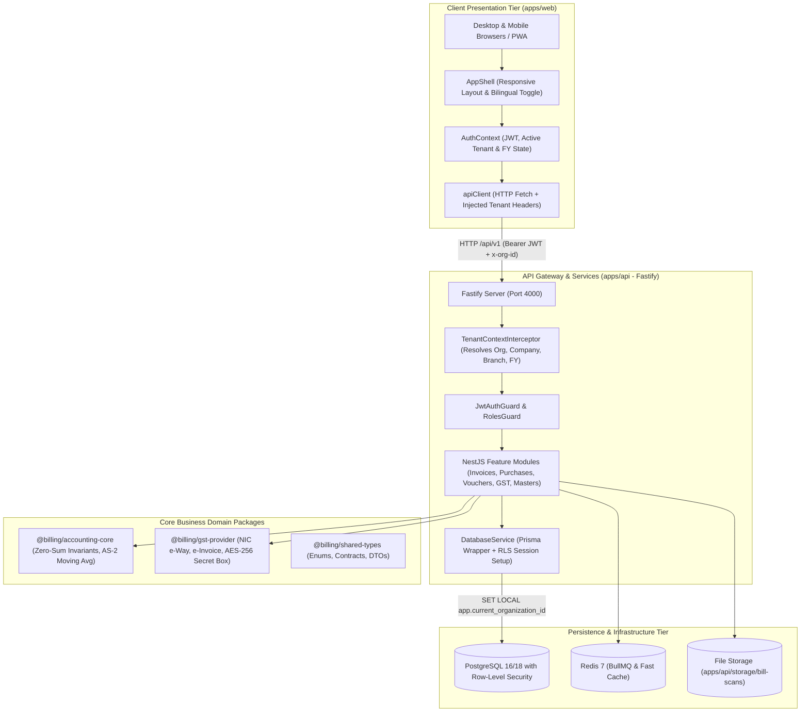
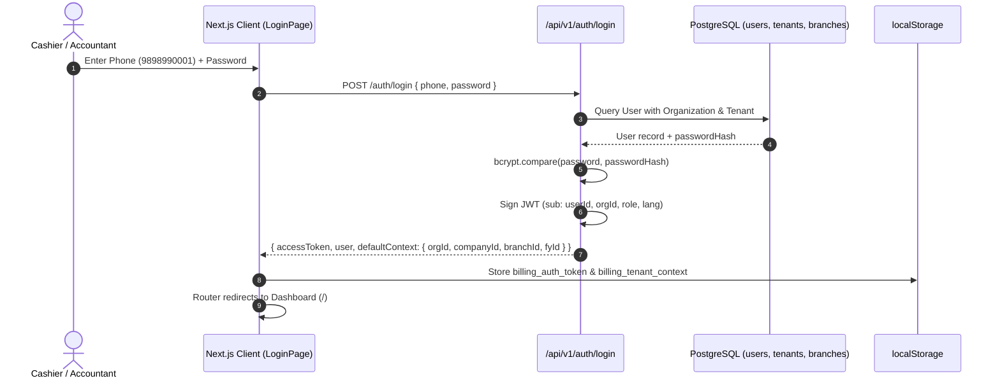
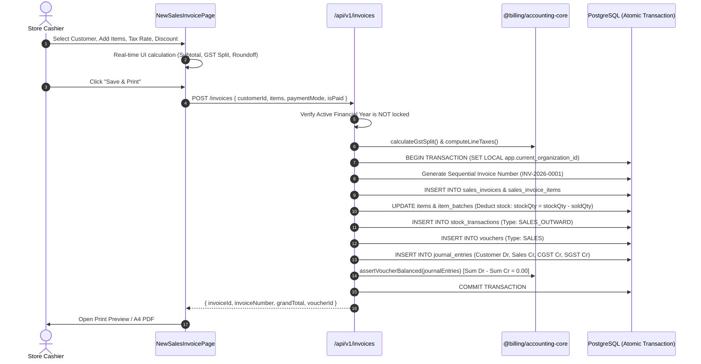
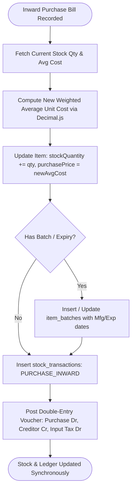
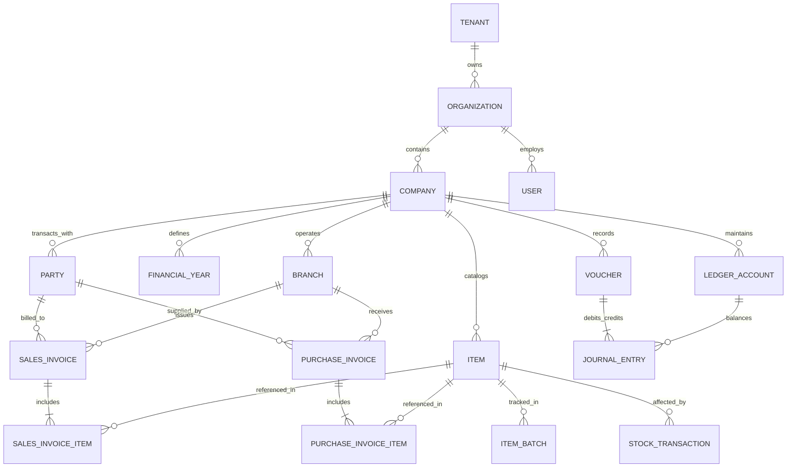

# 03 — System Architecture & End-to-End Data Flow

> **Audit Date:** October 14, 2026  
> **Repository:** `my_bill_history`  
> **Architecture Pattern:** Multi-Tenant Modular Monolith with Decoupled Next.js Frontend & NestJS Backend

---

## 1. High-Level Architectural Blueprint

The platform separates presentation, statutory business logic, and transactional persistence into clear, type-safe tiers orchestrated via pnpm workspaces:



---

## 2. Authentication & Multi-Tenant Context Resolution Flow

Every user belongs to an **Organization**. Inside an Organization, there can be multiple legal **Companies** (with different GSTINs) and multiple **Branches** (warehouses/outlets). All operations occur inside an active **Financial Year**.



---

## 3. Invoice Creation & Double-Entry Ledger Posting Flow

This is the most critical business workflow. When a sales invoice is created, it atomically updates:
1. Sales Invoice and line items.
2. Item physical stock and batch balances.
3. Customer accounts receivable ledger.
4. Output GST tax liability ledgers (CGST, SGST, IGST).
5. Sales Revenue ledger.
6. Cash or Bank ledger (if paid immediately).
7. General Ledger Double-Entry Voucher (`VOUCHER_TYPE: SALES`).



---

## 4. Product Inventory & Moving-Average Cost Valuation Flow

When goods arrive via a Purchase Invoice:
1. Vendor invoice details and line items are stored.
2. Inward stock transactions are created.
3. Item current stock quantity is increased.
4. The item's moving weighted average cost is recomputed under **Indian Accounting Standard 2 (AS-2)**:
   $$\bar{C}_{\text{new}} = \frac{(Q_{\text{current}} \times C_{\text{current}}) + (Q_{\text{inward}} \times C_{\text{inward}})}{Q_{\text{current}} + Q_{\text{inward}}}$$



---

## 5. Entity-Relationship Data Model (Core Domain Architecture)

The following diagram illustrates the relationship between the central tables in `packages/database/prisma/schema.prisma`:



---

## 6. Security & Multi-Tenancy Execution Architecture

The system avoids accidental cross-tenant data leaks through a two-layer defense mechanism:

1. **Application-Level Context Injection:**
   The `TenantContextInterceptor` reads the active `x-organization-id` header (validated against the user's signed JWT token) and attaches it to `req.tenantContext`.

2. **Database-Level Row-Level Security (RLS):**
   In `apps/api/src/database/database.service.ts`, queries run inside an interactive transaction:
   ```typescript
   await tx.$executeRaw`SELECT set_config('app.current_organization_id', ${ctx.organizationId}, true)`;
   await tx.$executeRawUnsafe(`SET LOCAL ROLE billing_app`);
   ```
   PostgreSQL executes the query under role `billing_app` (non-superuser), evaluating the table's RLS policy:
   ```sql
   CREATE POLICY tenant_isolation_policy ON sales_invoices
   FOR ALL TO billing_app
   USING (organization_id = NULLIF(current_setting('app.current_organization_id', true), '')::uuid);
   ```
   Even if an engineer writes `SELECT * FROM sales_invoices` without a `where` clause, PostgreSQL physically filters out all rows belonging to other tenants.
