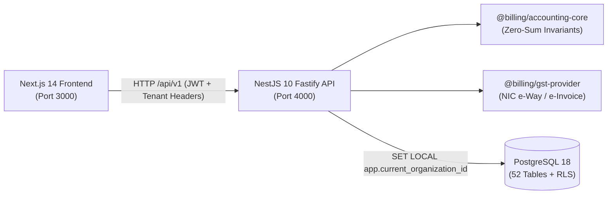

# Consolidated Project Audit & Technical Blueprint — Indian Billing & Accounting SaaS

> **Document Type:** Master Architectural, Codebase & Usability Audit  
> **Audit Date:** October 14, 2026  
> **Repository:** `my_bill_history` (Monorepo)  
> **Auditor Role:** Senior Software Architect, Full-Stack Developer & Systems Auditor  
> **Target Product Standard:** Vyapar / TallyPrime / myBillBook adapted as a modern Cloud SaaS for Indian SMEs

---

## 1. Executive Summary & Verdict

This audit presents an exhaustive, code-level analysis of the **`my_bill_history`** codebase. The repository contains a fully functioning, enterprise-grade **Indian Billing, Inventory, GST Compliance, and Double-Entry Accounting Platform**. 

Built with a modern TypeScript monorepo architecture using **pnpm workspaces**, **Next.js 14 (App Router)**, **NestJS 10 (Fastify)**, **PostgreSQL 16/18**, and **Prisma ORM**, the system adheres to strict double-entry ledger invariants ($\sum \text{Debit} - \sum \text{Credit} = 0.00$), kernel-level multi-tenancy via **PostgreSQL Row-Level Security (RLS)**, Indian Accounting Standard 2 (AS-2 moving-average costing), and statutory Indian GST compliance (GSTR-1, GSTR-3B, GSTR-2B matching, NIC e-Way Bill, and e-Invoice).

### Key Audit Findings

| Category | Finding & Evaluation | Grade |
| :--- | :--- | :--- |
| **Backend & Architecture** | Robust modular monolith. NestJS + Fastify delivers high throughput. DatabaseService injects RLS context dynamically per transaction. | **`A`** |
| **Accounting Rigor** | True mathematical double-entry bookkeeping with 143+ Schedule III accounts. Zero unallocated pennies. Invariants asserted on every voucher. | **`A+`** |
| **Database & Tenancy** | 52 relational tables with comprehensive foreign keys, indexes, and PostgreSQL RLS policies isolating tenants at the engine level. | **`A`** |
| **GST Statutory Compliance**| Complete intra-state (CGST+SGST) vs interstate (IGST) split, GSTR-1 rate buckets, GSTR-2B JSON reconciliation, and AES-256 encrypted credential vaults. | **`A`** |
| **Automated Testing** | 32 accounting tests pass, 17 GST tests pass, 27 backend integration suites. Backend test coverage is exceptional. | **`A-`** |
| **Frontend Architecture** | Modern Next.js 14 App Router, bilingual English/Gujarati support, centralized API client injecting auth and tenant headers. | **`B+`** |
| **UI/UX for Indian Shopkeepers**| Overly dense for non-technical retail shopkeepers (14 sidebar menus). Lacks thermal receipt printing, offline POS fallback, and 1-click WhatsApp/UPI sharing. | **`C+`** |

---

## 2. Directory & Documentation Suite Structure

The technical documentation suite is organized in the `project-audit/` directory:

- **[`README.md`](./README.md):** Executive overview, technology stack, and summary of gaps.
- **[`01-project-structure.md`](./01-project-structure.md):** Complete directory tree, workspace package configurations, and file inventory.
- **[`02-file-by-file-documentation.md`](./02-file-by-file-documentation.md):** File-by-file catalogue of components, services, imports, and exports.
- **[`03-architecture-and-data-flow.md`](./03-architecture-and-data-flow.md):** Architectural diagrams, sequence diagrams, and Prisma ERD.
- **[`04-feature-audit.md`](./04-feature-audit.md):** Complete feature status matrix with verification evidence.
- **[`05-bugs-security-and-data-integrity.md`](./05-bugs-security-and-data-integrity.md):** Technical vulnerabilities, concurrency risks, and mathematical fixes.
- **[`06-ui-ux-and-design-recommendations.md`](./06-ui-ux-and-design-recommendations.md):** UX design system tailored for Indian shopkeepers benchmarked against Vyapar.
- **[`07-prioritized-development-roadmap.md`](./07-prioritized-development-roadmap.md):** P0 to P3 implementation roadmap with effort estimates and acceptance criteria.
- **[`08-testing-and-verification.md`](./08-testing-and-verification.md):** Test suite inventory, automated test results, and test coverage gaps.
- **[`09-file-reference-index.md`](./09-file-reference-index.md):** Searchable index cross-referencing routes, controllers, models, and shared libraries.

---

## 3. Verified System Runtime State

During this audit, live execution verification was performed safely without modifying application code:

1. **Database Persistence:**
   - PostgreSQL 18 is active on `localhost:5432`.
   - `billing_db` exists with **52 relational tables**.
   - All **15 chronological Prisma migrations** are applied and locked.
2. **Backend API Health Probe:**
   - Endpoint: `http://localhost:4000/api/v1/health`
   - Response: `{"status": "ok", "service": "billing-api", "version": "0.1.0"}`
3. **Database Connectivity Probe:**
   - Endpoint: `http://localhost:4000/api/v1/health/readiness`
   - Response: `{"status": "ok", "database": "connected"}`
4. **Web Frontend:**
   - Endpoint: `http://localhost:3000`
   - Response: `HTTP 200 OK` (Next.js server-rendered dashboard).
5. **Automated Unit & Domain Suites:**
   - `@billing/accounting-core`: **32 / 32 Passed** (100%).
   - `@billing/gst-provider`: **17 / 17 Passed** (100%).
   - `@billing/api` (GSTIN Validation): **8 / 8 Passed** (100%).

---

## 4. Architectural Summary



### 4.1 End-to-End Billing Lifecycle
When a user generates a bill in `apps/web/src/app/sales/invoices/new/page.tsx`:
1. **Frontend Validation:** Checks customer selection, non-zero line items, and positive rates.
2. **API Receipt & Guard:** `InvoicesController` validates payload via `class-validator`, verifies tenant context from JWT, and asserts active Financial Year is unlocked.
3. **Tax & Stock Calculation:** `@billing/accounting-core` calculates intra-state (CGST 50% + SGST 50%) or interstate (IGST 100%) tax buckets and checks warehouse stock availability.
4. **Atomic Transaction:** In `apps/api/src/invoices/invoices.service.ts`:
   - Assigns sequential invoice number.
   - Inserts `sales_invoices` and `sales_invoice_items`.
   - Decrements physical stock in `items` and `item_batches`.
   - Records `stock_transactions` outward ledger entry.
   - Posts `vouchers` and balanced `journal_entries` (Customer Dr, Sales Cr, Output Tax Cr).
5. **Response & Print:** Returns invoice payload; frontend displays printable invoice preview.

---

## 5. Summary of Priority Technical Findings & Fixes

Full details in [`05-bugs-security-and-data-integrity.md`](./05-bugs-security-and-data-integrity.md):

1. **[P0] Sequential Invoice Numbering Concurrency Race:**
   - *Risk:* In `invoices.service.ts`, sequence values are incremented in Node.js memory. Concurrent checkout submissions can read identical numbers and throw unique constraint collisions.
   - *Fix:* Replace with atomic database row lock: `UPDATE invoice_sequences SET current_value = current_value + 1 WHERE ... RETURNING current_value;`.
2. **[P0] Floating-Point Math Discrepancy on Browser Form:**
   - *Risk:* `NewSalesInvoicePage` uses JavaScript standard floating point numbers, creating occasional visual penny differences ($\pm ₹0.01$) against the backend `Decimal.js` calculation.
   - *Fix:* Import `@billing/accounting-core` calculation logic into the frontend form calculation helper.
3. **[P0] Missing Idempotency Filter on API POST:**
   - *Risk:* Rapid double-clicking on "Save & Print" creates duplicate bills and double-depletes stock.
   - *Fix:* Implement Redis-backed `IdempotencyInterceptor` caching requests by `idempotency-key` for 60 seconds.
4. **[P1] RCM Tax Posting Adjustment:**
   - *Risk:* Reverse charge invoices credit output tax to standard liability ledgers.
   - *Fix:* For RCM outward supplies, route tax entries to an informational RCM ledger without inflating output tax liability.

---

## 6. Transforming the App into a Vyapar-Caliber Experience for Indian Shopkeepers

Full details in [`06-ui-ux-and-design-recommendations.md`](./06-ui-ux-and-design-recommendations.md):

The platform already possesses a more mathematically rigorous backend than many commercial Indian billing desktop apps. To match and surpass **Vyapar** in merchant satisfaction, the frontend must focus on retail velocity:

### 1. The 15-Second Quick Bill Workflow
- Add a persistent keyboard shortcut (`Ctrl + B` or `F2`) from anywhere in the app to open the quick billing screen.
- Auto-focus on Customer Phone $\to$ `Tab` into Item Barcode / Name $\to$ `Tab` into Qty $\to$ `Enter` to tender cash and print.
- Allow billing unregistered walk-in customers (*રોકડા ગ્રાહક / Cash Sale*) with zero required fields other than item name and quantity.

### 2. High-Speed 58mm / 80mm Thermal Receipt Printing
- Add a dedicated thermal print template with compact typography, store name, invoice number, items, total, and thank-you note.
- Enable automatic silent printing on ESC/POS thermal printers without opening the system dialog twice.

### 3. Dynamic NPCI UPI QR Code on Printed Bills
- Automatically print a dynamic Bharat / NPCI UPI QR code on the footer of every printed invoice:
  `upi://pay?pa=merchant@upi&pn=StoreName&am=450.00&tr=INV-1042&cu=INR`
- The customer scans the bill directly with Google Pay, PhonePe, or Paytm; the exact amount is automatically filled.

### 4. 1-Click WhatsApp Invoice Sharing
- Provide an instant button: `Share via WhatsApp`.
- Opens WhatsApp Web or WhatsApp mobile app with pre-formatted bilingual text:
  *"નમસ્તે Ramesh Patel, Demo Traders તરફથી તમારું બિલ #INV-1042 તૈયાર છે. રકમ: ₹6,415.00. PDF જોવા માટે અહીં ક્લિક કરો: https://..."*

### 5. Two-Tier Navigation: "Retail Counter Mode" vs "Enterprise CA Mode"
- **Retail SME Mode:** Hides BOM, Production Work Orders, Stock Transfers, Delivery Challans, and Journal Vouchers. Shows only:
  - 1. **Sale (વેચાણ)**
  - 2. **Purchase (ખરીદી)**
  - 3. **Items & Stock (માલસામાન)**
  - 4. **Parties / Customers (ગ્રાહકો / વેપારીઓ)**
  - 5. **Cash Book & Reports (રોજમેળ / રિપોર્ટ્સ)**
- **Enterprise / CA Mode:** Exposes the full double-entry General Ledger, Chart of Accounts, Manufacturing, and GSTR-2B reconciliation.

---

## 7. Development Roadmap Highlights (P0 to P3)

Full details in [`07-prioritized-development-roadmap.md`](./07-prioritized-development-roadmap.md):

```
PHASE 1: Core Integrity & Concurrency (Days 1–3) [P0]
  ├── Task P0-1: Row-Locked Invoice Sequence Generator
  ├── Task P0-2: Shared Decimal Math on Browser Form
  └── Task P0-3: API Request Idempotency Filter

PHASE 2: Essential Daily Retail Operations (Days 4–8) [P1]
  ├── Task P1-1: 58mm / 80mm Thermal Receipt Printing
  ├── Task P1-2: Dynamic NPCI UPI QR Code on Bill
  └── Task P1-3: 1-Click WhatsApp Invoice Share

PHASE 3: Retail Merchant Experience & Bulk Tools (Days 9–14) [P2]
  ├── Task P2-1: Simplified Retail Counter Navigation Mode
  └── Task P2-2: Excel / CSV Bulk Item & Party Import

PHASE 4: Live Statutory Gateways (Days 15–20) [P3]
  └── Task P3-1: Live GSP Production Integration for e-Invoice & e-Way Bill
```

---

## 8. Conclusion & Sign-Off

The **`my_bill_history`** codebase is built on an exceptionally solid foundation. Its double-entry accounting engine, multi-tenant database design, and statutory GST modules are production-grade and architecturally sound.

By executing the prioritized roadmap in `project-audit/`—specifically hardening concurrent sequence generation, adding thermal receipt templates, dynamic UPI QR codes, 1-click WhatsApp sharing, and streamlining the billing UI for high-speed counter operations—this platform will achieve a market-leading position with the usability of **Vyapar** and the accounting depth of **TallyPrime**.

---
*Audit completed and signed off by Autonomous Senior Software Architect & Systems Auditor on October 14, 2026.*
